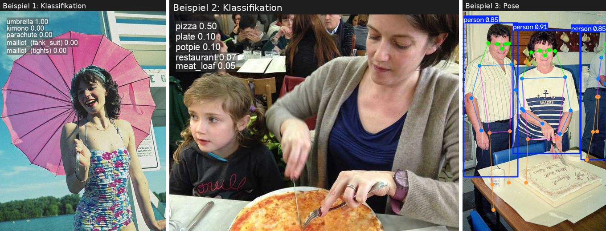
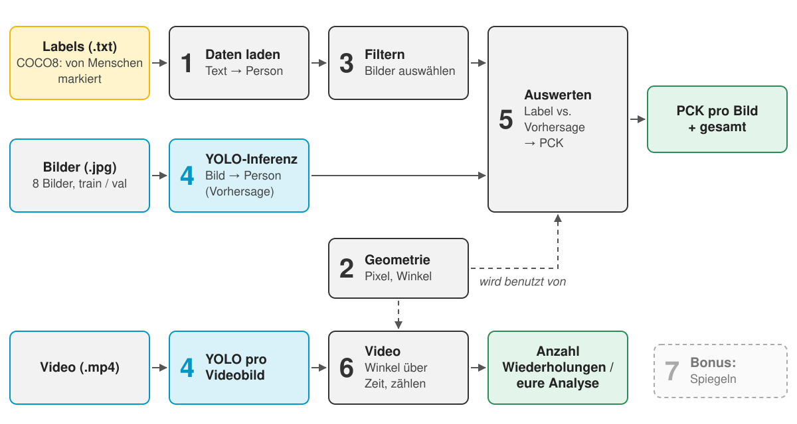
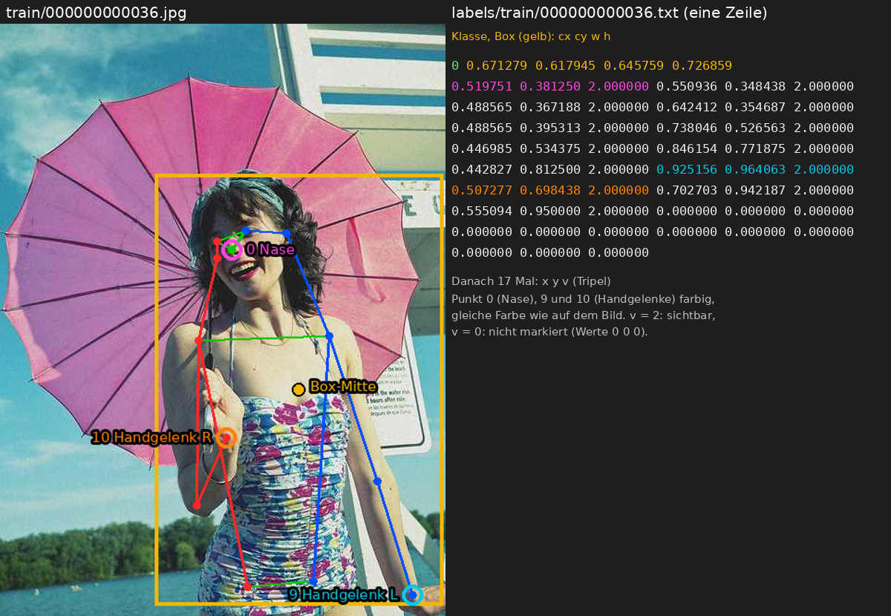
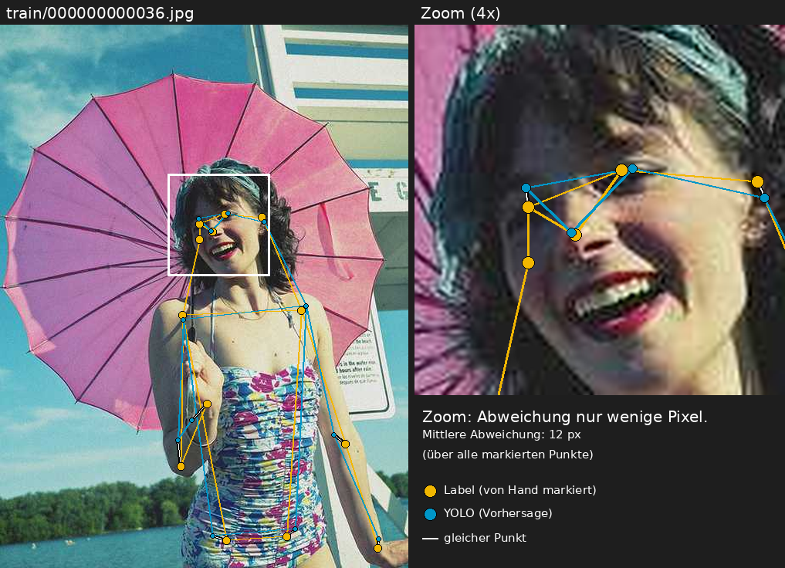
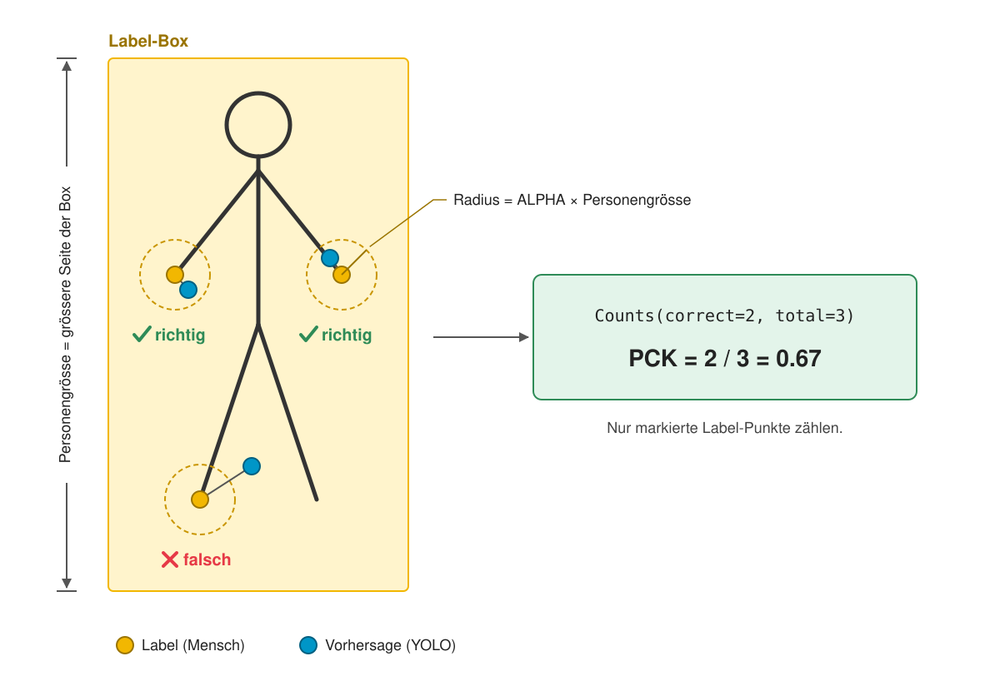
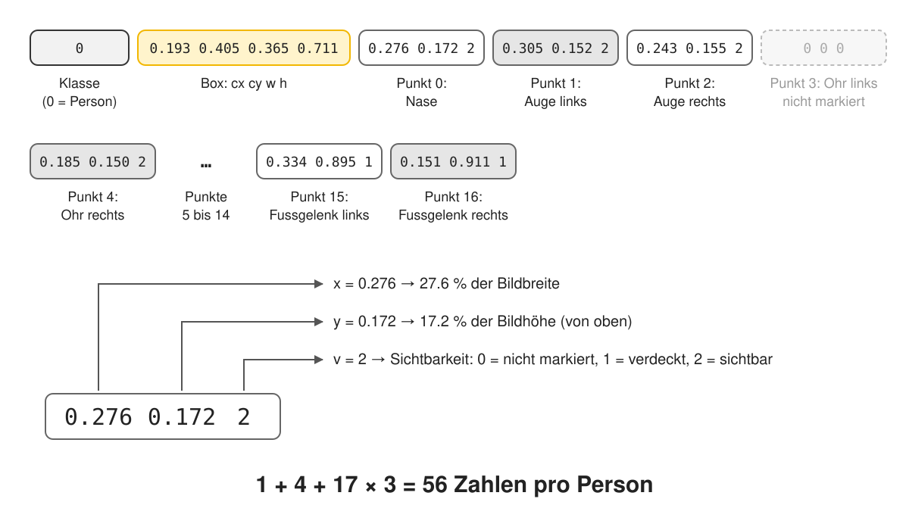
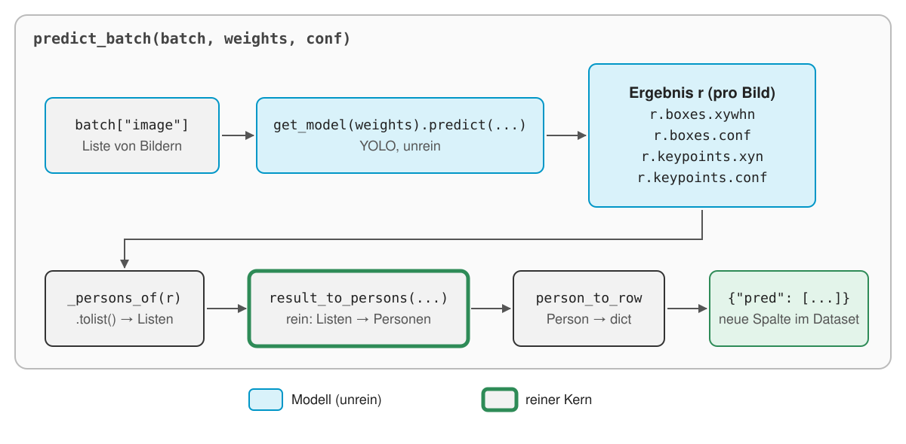
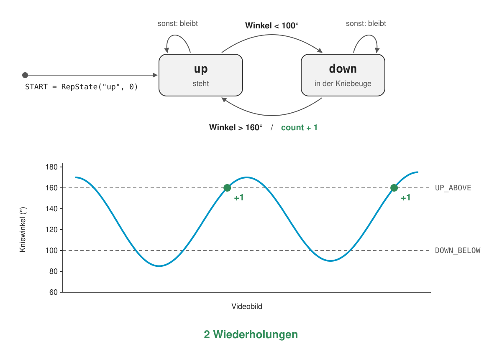

# Modul 323: Pose-Pipeline

Funktionale Programmierung (FP) ist nicht an Haskell gebunden: Ihre Prinzipien wie unveränderliche Daten, pure functions und Funktionen als Werte stecken in fast allen modernen Sprachen und Frameworks. In diesem Projekt lernt ihr sie an einem konkreten Beispiel kennen: einer kleinen Computer-Vision-Pipeline in Python, die Personen und ihre Gelenke auf Bildern und in Videos erkennt. In **Runde 1** baut ihr die Pipeline, in **Runde 2** findet ihr die FP-Prinzipien in eurem eigenen Code und in der Software, die ihr in eurem Lehrbetrieb entwickelt.

> **Bewertet wird euer Bericht [bericht.md](bericht.md) (20 Punkte).** Ihr füllt ihn während des ganzen Projekts aus. Welcher Teil wann dran ist, steht im [Ablauf](#ablauf-auf-einen-blick) und am Ende jedes Schritts (→ bericht.md).

## Los geht's: YOLO in 5 Zeilen

Ein trainiertes Modell zu benutzen, ist erstaunlich wenig Code. Probiert es aus, bevor ihr weiterlest.

> **Vorher:** Repo eingerichtet und `uv sync` ausgeführt? Sonst zuerst [Setup](#setup).

Legt im Projektordner eine Datei `erste_schritte.py` an und startet sie mit `uv run python erste_schritte.py`.

**Beispiel 1: Was ist auf dem Bild?** (Klassifikation)

```python
from ultralytics import YOLO

model = YOLO("yolo11n-cls.pt")                     # Modell laden (wird beim ersten Mal heruntergeladen)
result = model("data/coco8-pose/images/train/000000000036.jpg", verbose=False)[0]
print("Das ist:", result.names[result.probs.top1], f"({result.probs.top1conf:.0%} sicher)")
result.save("out/klassifikation.jpg")              # Bild mit Ergebnis speichern (legt out/ an)
```

Ausgabe: `Das ist: umbrella (100% sicher)`

**Beispiel 2:** Ändert nur den Bildpfad auf `data/coco8-pose/images/val/000000000110.jpg`. Ausgabe: `Das ist: pizza (50% sicher)`.

**Beispiel 3: Wo sind die Personen und ihre Gelenke?** (Pose)

```python
from ultralytics import YOLO

model = YOLO("yolo11n-pose.pt")                    # nur der Modellname ist anders
result = model("data/coco8-pose/images/val/000000000113.jpg", verbose=False)[0]
print("Personen gefunden:", len(result.boxes))
print("Nase der ersten Person (x, y):", result.keypoints.xy[0][0].int().tolist())
result.save("out/pose.jpg")
```

Ausgabe:

```
Personen gefunden: 3
Nase der ersten Person (x, y): [239, 129]
```



Öffnet die Bilder in `out/`. Statt `result.save(...)` zeigt `result.show()` das Bild direkt an.

**Probiert selbst:**

- Ein eigenes Foto (Haustier, etwas auf dem Tisch) mit dem Klassifikationsmodell. Am besten klappt es mit **einem** grossen Gegenstand in der Mitte.
- `val/000000000136.jpg` mit dem Klassifikationsmodell. Was sagt es, und was ist wirklich auf dem Bild? Warum liegt es daneben? (Tipp: Das Modell kennt nur 1000 feste Kategorien und muss sich immer für eine entscheiden.)

**Merkt euch:** Beispiel 3 liefert genau die Daten, mit denen wir arbeiten: pro Person eine Box und 17 Punkte mit Koordinaten.

---

## Inhalt

- [Los geht's: YOLO in 5 Zeilen](#los-gehts-yolo-in-5-zeilen)
0. [Worum es geht](#0-worum-es-geht): Ablauf, Pipeline, Daten, Team, Setup
1. [YOLO und Pose](#1-yolo-und-pose)
2. [Runde 1: Implementieren](#2-runde-1-implementieren)
   - [Schritt 1: Daten laden](#schritt-1-daten-laden) · [2: Geometrie](#schritt-2-geometrie) · [3: YOLO](#schritt-3-yolo) · [4: Video](#schritt-4-video) · [4b: eigene Analyse (optional)](#4b-eure-eigene-analyse-optional)
3. [Runde 2: FP-Prinzipien](#3-runde-2-fp-prinzipien)
   - [3.0 FP ist überall + Recherche](#30-fp-ist-überall) · [3.1 Immutability](#31-immutability-und-aliasing) · [3.2 Pure functions](#32-pure-functions) · [3.3 Functional core, Memoization](#33-functional-core-imperative-shell-und-memoization) · [3.4 State as a value, Fold](#34-state-as-a-value-und-fold)
4. [Bericht und Abgabe](#4-bericht-und-abgabe)
5. [Spickzettel](#5-spickzettel)

---

## 0. Worum es geht

**In einem Satz:** Bild rein, Personen mit 17 Gelenkpunkten raus, daraus Winkel berechnen und Bewegungen zählen.

### Ablauf auf einen Blick

Zusammen ca. 4 Stunden (Richtwert).

| # | Was ihr macht | Zeit | In [bericht.md](bericht.md) |
|---|---|---|---|
| 1 | [Setup](#setup), [Los geht's](#los-gehts-yolo-in-5-zeilen), [Kapitel 1](#1-yolo-und-pose) lesen | 30 min | Team und Repo-Link eintragen |
| 2 | **Runde 1:** Schritte 1 bis 4a programmieren, bis die Tests grün sind | 1 h 30 | Teil A, **Frage 1** pro Schritt |
| 3 | **Runde 2, 3.0:** Recherche im Lehrbetrieb (jede Person) | 30 min | Teil B (ein Block pro Person) |
| 4 | **Runde 2, 3.1 bis 3.4:** `bad/`-Skripte starten, beobachten | 45 min | Teil A, **Fragen 2 und 3** pro Schritt |
| 5 | Bericht fertig machen, abgeben | 15 min | Teil C |
| 6 | Puffer | 30 min | |
| | **Optional zum Schluss:** Schritt 4b, eure eigene Analyse | so weit ihr kommt | optionaler Abschnitt |

**Nur der Bericht gibt Punkte** (20 Punkte). Der Code (Tests grün) ist Voraussetzung. Details in [Kapitel 4](#4-bericht-und-abgabe).

### Die Pipeline



Die Nummern im Bild sind **nicht** eure Schritte. So gehören sie zusammen:

| Im Bild | Bei uns | Datei |
|---|---|---|
| 1 Daten laden | **Schritt 1** | `pipeline/data.py` |
| 2 Geometrie | **Schritt 2** | `pipeline/geometry.py` |
| 4 YOLO-Inferenz | **Schritt 3** | `pipeline/inference.py` |
| 6 Video | **Schritt 4** | `pipeline/reps.py` |
| 3 Filtern, 5 Auswerten, 7 Spiegeln | fertig vorgegeben | |

### Der Datensatz: COCO

**COCO** ist ein grosser, öffentlicher Datensatz mit Alltagsfotos. Bei vielen Personen haben Menschen von Hand 17 Körperpunkte markiert (Nase, Schultern, Ellbogen, ...). Wir nutzen **COCO8-Pose**: nur 8 Bilder davon, bereits im Repo.

```
data/coco8-pose/
├── images/
│   ├── train/   000000000036.jpg, ...   (4 Bilder)
│   └── val/     ...                     (4 Bilder)
└── labels/
    ├── train/   000000000036.txt, ...
    └── val/     ...
```

Bild und Label-Datei haben **denselben Namen** (`.jpg` bzw. `.txt`). Pro Person gibt es eine Zeile. (Die `.cache`-Dateien könnt ihr ignorieren.) Beispiel: `train/000000000036.jpg` zeigt eine Person mit Schirm, also hat `000000000036.txt` genau eine Zeile:



```
0 0.671279 0.617945 0.645759 0.726859 0.519751 0.381250 2.000000 0.550936 0.348438 2.000000 ... 0.000000 0.000000 0.000000
```

`0` heisst "Person", dann folgt die Box, dann 17 × (`x y v`). Genau erklärt in [Kapitel 1](#eine-label-zeile-zerlegt).

### Label und Vorhersage: Wie gut ist das Modell?

Die Labels sind **von Hand markiert** und gelten als die richtige Antwort (*ground truth*). YOLO bekommt nur das Bild und **sagt** dieselben 17 Punkte **vorher**. Darum können wir beides direkt vergleichen: Labels gelb, YOLO cyan.



Ein vorhergesagter Punkt zählt als **richtig**, wenn er näher beim Label-Punkt liegt als eine **Toleranz** (10 % der Personengrösse). **PCK** ist der Anteil der richtigen Punkte. Für unsere 4 `val`-Bilder liegt er bei etwa **0.78** (90 von 116 Punkten).



Das ist nur zum Verstehen, ihr müsst nichts davon rechnen.

### Team und KI

- Teams von **2 bis 4 Personen**. Teilt die 4 Schritte auf, aber **alle** müssen jeden Schritt erklären können. Die Recherche im Betrieb (3.0) macht **jede Person** für den eigenen Lehrbetrieb.
- KI-Assistenten sind **erlaubt und erwünscht**: Funktionen erklären lassen, Fehlermeldungen deuten, Tests erläutern. Gebt der KI den Docstring und den Test mit, dann werden die Vorschläge viel besser.
- **Versteht, was ihr übernehmt.** Die Erklärungen im Bericht müssen von euch kommen. In Teil C beschreibt ihr, wo die KI geholfen hat und wo sie falsch lag.

### Setup

**Voraussetzungen:** pro Person ein **GitHub-Konto**, dazu **git** und **uv**. uv installieren:

- macOS / Linux: `curl -LsSf https://astral.sh/uv/install.sh | sh`
- Windows (PowerShell): `powershell -ExecutionPolicy ByPass -c "irm https://astral.sh/uv/install.ps1 | iex"`

**Repo einrichten (einmal pro Team):**

1. **Eine Person** öffnet dieses Repo auf GitHub und klickt **"Use this template" → "Create a new repository"**. **Nicht forken:** Ein Fork ist öffentlich, dann sieht die ganze Klasse euren Code.
2. Name z.B. `m323-pose-<eure-namen>`, Sichtbarkeit **Private**, dann **Create repository**.
3. **Settings → Collaborators → Add people:** alle anderen Teammitglieder und die **Lehrperson** (GitHub: `tinunit`).
4. Alle klonen das neue Repo:

   ```bash
   git clone git@github.com:<euer-konto>/<euer-repo>.git
   cd <euer-repo>
   uv sync                # installiert alles (einmalig, dauert ein paar Minuten)
   uv run pytest -q       # Setup prüfen
   ```

Am Anfang sind etwa 25 Tests rot (`failed`): alle, die eure noch leeren Funktionen brauchen. Der Rest ist grün. Am Schluss muss alles grün sein. Das Modell `yolo11n-pose.pt` (6 MB) wird beim ersten Aufruf automatisch heruntergeladen. **Alle Befehle startet ihr im Projektordner.**

**Zusammenarbeiten:** Vor dem Arbeiten `git pull`, danach `git add`, `git commit`, `git push`. Arbeitet in verschiedenen Dateien, dann gibt es keine Konflikte. Ein Commit pro Schritt.

---

## 1. YOLO und Pose

Ihr braucht kein Wissen über neuronale Netze, nur ein Bild davon, was aus dem Modell herauskommt.

### Was ist YOLO?

YOLO ("You Only Look Once") ist ein Modell, das ein Bild **einmal** ansieht und direkt Ergebnisse liefert. Wir benutzen ein fertig trainiertes Modell, trainiert wird hier nichts. Es gibt vier Arten von Aufgaben:


| Aufgabe | Frage ans Bild | Ausgabe |
|---|---|---|
| Klassifikation | Was ist das? | **eine** von 1000 festen Kategorien |
| Detektion | Was ist wo? | Boxen mit Klasse und Konfidenz |
| Segmentierung | Welche Pixel gehören dazu? | Masken |
| **Pose** (unsere) | Wo sind die Gelenke? | Box + 17 Punkte pro Person |

Merkt euch: Modelle sagen **immer** etwas, auch wenn sie falsch liegen (siehe Bild 136 in "Los geht's").

### Die 17 Keypoints


| Idx | Name | Idx | Name | Idx | Name |
|---|---|---|---|---|---|
| 0 | Nase | 6 | rechte Schulter | 12 | rechte Hüfte |
| 1 | linkes Auge | 7 | linker Ellbogen | 13 | linkes Knie |
| 2 | rechtes Auge | 8 | rechter Ellbogen | 14 | rechtes Knie |
| 3 | linkes Ohr | 9 | linkes Handgelenk | 15 | linkes Fussgelenk |
| 4 | rechtes Ohr | 10 | rechtes Handgelenk | 16 | rechtes Fussgelenk |
| 5 | linke Schulter | 11 | linke Hüfte | | |

"Links" und "rechts" sind aus Sicht der Person, nicht des Betrachters. Für den Kniewinkel brauchen wir Hüfte, Knie, Fussgelenk: **11, 13, 15** (links) bzw. **12, 14, 16** (rechts).

### Eine Label-Zeile zerlegt

Hier die erste Person aus `000000000113.txt` (der Mann in den Abbildungen), Zahlen auf 3 Stellen gekürzt:



Aufbau: `Klasse | cx cy w h | (x y v) × 17` = 1 + 4 + 51 = **56 Zahlen**.

| Feld | Bedeutung |
|---|---|
| Klasse | immer `0` (Person) |
| `cx cy w h` | **Mitte** der Box (nicht die Ecke oben links) und ihre Breite und Höhe |
| `x y` | Position des Punkts |
| `v` | Sichtbarkeit: **0** = nicht markiert, **1** = markiert aber verdeckt, **2** = markiert und sichtbar |

Ist ein Punkt `0 0 0` (im Beispiel Punkt 3, linkes Ohr), ist er nicht markiert, und die Position ist bedeutungslos.

### Koordinaten: normalisiert und Pixel


Der Ursprung `(0, 0)` liegt **oben links**. `x` wächst nach rechts, **`y` wächst nach unten** (anders als in der Mathematik).

| | Pixel | Normalisiert |
|---|---|---|
| Bereich | `x`: 0 bis Breite, `y`: 0 bis Höhe | `x` und `y`: 0 bis 1 (Anteil der Breite bzw. Höhe) |
| Beispiel (Ellbogen R oben, Bild 416 × 640) | `(19, 260)` | `(19 / 416, 260 / 640)` = `(0.046, 0.406)` |
| Wo | zum Zeichnen und für Winkel | in den Label-Dateien und in der YOLO-Ausgabe (`xywhn`, `xyn`) |

Umrechnen (das macht `to_pixels` in Schritt 2): `x_px = x * breite`, `y_px = y * hoehe`.

**Warum Winkel in Pixeln?** Normalisiert wird jedes Bild auf ein Quadrat 1 × 1 "gequetscht" (rechte Hälfte der Abbildung). Strecken kippen, und Winkel stimmen nicht mehr. Im Beispiel: Ellbogenwinkel **146.8°** in Pixeln, aber **130.7°** normalisiert gerechnet.

### Die YOLO-Ausgabe hat denselben Aufbau

```python
model = YOLO("yolo11n-pose.pt")
results = model.predict(images, conf=0.25, verbose=False, device="cpu")  # images: Liste von Bildern
for r in results:                                        # ein Ergebnis pro Bild
    r.boxes.xywhn        # (n, 4)     Boxen cx cy w h, normalisiert   ← wie cx cy w h im Label
    r.boxes.conf         # (n,)       Konfidenz pro Person            (im Label: immer 1.0)
    r.keypoints.xyn      # (n, 17, 2) Punkte x y, normalisiert        ← wie x y im Label
    r.keypoints.conf     # (n, 17)    Konfidenz pro Punkt             ← an der Stelle von v
```

`n` ist die Anzahl erkannter Personen (kann 0 sein). Mit `.tolist()` werden daraus normale Python-Listen.

**Zwei Unterschiede**, die später wichtig werden:

1. **`v` ist nicht gleich `conf`.** Im Label ist `v` eine Sichtbarkeit (0/1/2), in der Vorhersage eine Konfidenz (0.0 bis 1.0, praktisch nie genau 0). "Markiert, wenn `v > 0`" gilt nur für Labels.
2. **YOLO liefert immer alle 17 Punkte.** Auch verdeckte Punkte werden geraten, nur mit tiefer Konfidenz.

### Unsere Datentypen

In `pipeline/types.py`, unveränderlich (`NamedTuple`):

```python
class Keypoint(NamedTuple):      # z.B. die Nase: Keypoint(x=0.520, y=0.381, v=2.0)
    x: float                       # 0 = links, 1 = rechts
    y: float                       # 0 = oben, 1 = unten
    v: float                       # Label: 0 / 1 / 2 (siehe oben). Vorhersage: Konfidenz 0..1

class Person(NamedTuple):
    box: tuple[float, float, float, float]   # cx, cy, w, h
    keypoints: tuple[Keypoint, ...]          # immer genau 17
    score: float = 1.0                       # Label: 1.0. Vorhersage: Konfidenz
```

---

## 2. Runde 1: Implementieren

In Runde 1 ergänzt ihr **nur die `# TODO`-Stellen** in vier Dateien. Alles andere ist fertig.

| Schritt | Datei | Ihr ergänzt | Test |
|---|---|---|---|
| 1 | `pipeline/data.py` | `parse_label_line`: `box` und `kps` | `tests/test_data.py` |
| 2 | `pipeline/geometry.py` | `to_pixels`: `kps`; `knee_angle` | `tests/test_geometry.py` |
| 3 | `pipeline/inference.py` | `get_model`; `result_to_persons`: `kps` | `tests/test_inference.py` |
| 4 | `pipeline/reps.py` | `step` (zwei Fälle); `count_reps` | `tests/test_reps.py` |

**So geht ihr pro Schritt vor:**

1. Docstring und TODO-Kommentare lesen. Sie beschreiben genau, was die Funktion tun soll.
2. Code ergänzen und die Zeile `raise NotImplementedError(...)` löschen.
3. Prüfen: Test grün, dann das Programm laufen lassen.
4. In [bericht.md](bericht.md) Teil A, **Frage 1** für diesen Schritt beantworten, dann committen.

**Regeln:** Funktionen **verändern ihre Argumente nicht**, sie geben neue Werte zurück. Verwendet `Keypoint` und `Person`. **Pure.** im Docstring heisst: pure function, nur Eingabe und Ausgabe. **Impure.** heisst: hat *side effects* (Dateien, Modell, Video).

### Schritt 1: Daten laden

**Ziel:** Eine Label-Zeile in eine `Person` umwandeln. **FP-Thema:** Immutability (`Person` und `Keypoint` lassen sich nach dem Bauen nicht ändern).

**Eure Aufgabe:** `parse_label_line(line)` in `pipeline/data.py`

| Eingabe | Ausgabe |
|---|---|
| **eine Zeile** als `str`, z.B. `"0 0.193 0.405 … 0.151 0.911 1"` | **eine** `Person` (Box + 17 `Keypoint`), oder `None` |

Schon da: Zeile aufteilen, Anzahl prüfen, in Zahlen umwandeln (`nums`, ein Tupel mit 56 Zahlen) und `return Person(box=box, keypoints=kps)`. **Ihr ergänzt nur `box` und `kps`.** Datei lesen und Dataset bauen macht der gegebene Code (`load_split`): Eure Funktion bekommt nur Text und gibt Werte zurück.

**Hinweis:**

```python
# nums = (0.0, 0.67, 0.62, 0.65, 0.73, 0.52, 0.38, 2.0, 0.55, 0.35, 2.0, ...)
#          │    └──── box ─────────┘  └─ Keypoint 0 ─┘ └─ Keypoint 1 ─┘
#        Klasse
# Slicing: nums[a:b] gibt die Elemente a bis b-1 als Tupel
# Keypoint i steht an nums[5 + 3*i : 8 + 3*i]   ->  Keypoint(x, y, v)
# 17 Keypoints als Tupel: tuple(... for i in range(17))
```

**Prüfen:**

```bash
uv run pytest tests/test_data.py -q     # alle grün
uv run python -m pipeline.data          # pro Split 4 Bilder mit Anzahl Personen und Punkten
```

**→ [bericht.md](bericht.md), Teil A, Schritt 1, Frage 1.** Commit, z.B. `git commit -m "Schritt 1: Daten laden"`.

### Schritt 2: Geometrie

**Ziel:** Normalisierte Koordinaten in Pixel umrechnen und den Kniewinkel bestimmen. **FP-Thema:** pure functions (`to_pixels` gibt eine **neue** `Person` zurück, die Eingabe bleibt).

**Gegeben:** `KNEE_JOINTS` und `angle_at(a, b, c)`: der Winkel in Grad bei `b` (0 bis 180), oder `None`, wenn eine Strecke Länge 0 hat.

**Eure Aufgabe** (`pipeline/geometry.py`):

| Funktion | Eingabe | Ausgabe | Was passiert |
|---|---|---|---|
| `to_pixels(p, width, height)` | **eine** `Person` (normalisiert) + Bildbreite und -höhe in Pixeln | **eine neue** `Person` in Pixeln | Die Box ist schon umgerechnet. Ihr ergänzt `kps`: `x * width`, `y * height` für alle 17 Punkte, `v` bleibt |
| `knee_angle(p_px, side)` | **eine** `Person` in Pixeln + `"left"` oder `"right"` | Kniewinkel in Grad, oder `None` | `hip, knee, ankle` stehen schon bereit. `None`, wenn einer davon nicht markiert ist (`v <= 0`), sonst `angle_at(hip, knee, ankle)` |

Gestreckt ≈ 180°, tiefe Kniebeuge ≈ 70–90°. Gerechnet wird in **Pixeln** (siehe [Koordinaten](#koordinaten-normalisiert-und-pixel)), darum kommt `to_pixels` vor `knee_angle`.

**Hinweis:**

```python
# Ein Keypoint ist ein NamedTuple: k.x, k.y, k.v. Einen neuen baut man mit Keypoint(x, y, v).
# Ein Tupel aus einer Schleife: tuple(f(k) for k in p.keypoints)
# knee_angle: früh aussteigen mit  if <Bedingung>: return None
```

**Prüfen:**

```bash
uv run pytest tests/test_geometry.py -q
uv run python -m pipeline.geometry      # Kniewinkel pro Person, Bild out/skeleton.png
```

Sitzt das Skelett in `out/skeleton.png` auf der Person?

**→ [bericht.md](bericht.md), Teil A, Schritt 2, Frage 1.** Commit.

### Schritt 3: YOLO

**Ziel:** Das Modell laden und seine Ausgabe in `Person`-Objekte übersetzen. **FP-Thema:** functional core, imperative shell und memoization.

**Gegeben:** alles Übrige in `pipeline/inference.py`, u.a. `predict_image` (ein Bild → Personen) und `confident` (Punkte mit Konfidenz `< 0.5` bekommen `v = 0`, damit `knee_angle` für geratene Knie `None` liefert). So hängen die Funktionen zusammen:



**Eure Aufgabe** (`pipeline/inference.py`):

| Funktion | Eingabe | Ausgabe | Was passiert |
|---|---|---|---|
| `get_model(weights)` | Dateiname, z.B. `"yolo11n-pose.pt"` | das Modell (`YOLO`) | Modell laden, eine Zeile wie in "Los geht's". `@lru_cache` darüber sorgt dafür, dass es nur **einmal** geladen wird |
| `result_to_persons(boxes_xywhn, boxes_conf, kps_xyn, kps_conf)` | **vier Listen** mit den Feldern aus Kapitel 1, für `n` Personen | **Tupel von Personen** (keine Erkennung → `()`) | Die Schleife ist schon da. Ihr ergänzt `kps`: 17 × `Keypoint(x, y, konfidenz)` |

`result_to_persons` ist **pure**: nur Zahlenlisten rein, Personen raus, ohne Modell testbar. Das ist der *Kern*. `get_model` und `predict_image` sind die *Schale*.

**Hinweis:**

```python
# zip läuft über mehrere Listen gleichzeitig; Paare lassen sich direkt auspacken:
for (x, y), v in zip([[0.5, 0.2], [0.6, 0.3]], [0.9, 0.8]):
    print(x, y, v)                     # 0.5 0.2 0.9  /  0.6 0.3 0.8
```

**Prüfen:**

```bash
uv run pytest tests/test_inference.py -q
uv run python -m pipeline.inference data/coco8-pose/images/val/000000000110.jpg
```

Der zweite Befehl druckt die Kniewinkel und schreibt `out/annotated.png`: Das Skelett muss auf den Personen sitzen. Mit `uv run python visualize.py` seht ihr Label und Vorhersage nebeneinander (`out/vis_val.png`).

**Eigenes Foto:**

1. Legt ein Foto in den Ordner `eigene/` (anlegen, falls er fehlt). Am besten **von der Seite**, **ganzer Körper**, gut beleuchtet. Handyfotos gehen, Drehung und Grösse korrigiert das Skript.
2. `uv run python run_own.py`
3. Ergebnisse (Skelett und Kniewinkel) liegen in `out/eigene/`. Funktioniert die Erkennung? Was passiert mit dem Winkel, wenn das Knie verdeckt ist?

Eigene Fotos kommen **nicht** ins Repo (`eigene/` steht in der `.gitignore`).

**→ [bericht.md](bericht.md), Teil A, Schritt 3, Frage 1.** Commit.

### Schritt 4: Video

**Ziel:** Kniebeugen in einem Video zählen. **FP-Thema:** state as a value (ein *Reducer*) und fold.

#### 4a: Kniebeugen zählen

**Video aufnehmen:** Filmt euch gegenseitig, etwa 10 Kniebeugen in 10 bis 20 Sekunden. Legt das Video in den Ordner `videos/` (anlegen; er steht in der `.gitignore`).

- **Kopf und Füsse** im Bild, 3 bis 4 m Abstand, **genau von der Seite**.
- Kamera ruhig (Stativ oder ablegen). Nicht ins Bild hinein- oder hinauslaufen.

**Gegeben** (`pipeline/reps.py`): `RepState`, `START`, die Schwellen `DOWN_BELOW` und `UP_ABOVE`, `frames`, `angles`, `drop_missing`, `ema`, `states` und die erste Regel von `step`.

**Eure Aufgabe** (`pipeline/reps.py`):

| Funktion | Eingabe | Ausgabe | Was passiert |
|---|---|---|---|
| `step(state, angle)` | **ein** `RepState` (z.B. `RepState("up", 3)`) + **ein** Winkel | **ein neuer** `RepState` | Ihr ergänzt die Rückkehr von `down` nach `up` (mit `count + 1`) und den Fall "nichts passiert" |
| `count_reps(xs)` | Liste von Winkeln, z.B. `[170, 90, 165, 85, 170]` | Anzahl Wiederholungen, hier `2` | `step` über die ganze Liste anwenden, beginnend bei `START`, am Schluss `.count` |



`step` hat **zwei Schwellen**: von `up` nach `down` unter `DOWN_BELOW` (100°), von `down` nach `up` über `UP_ABOVE` (160°). Dabei zählt `count` eins hoch.

**Hinweis:**

```python
step(RepState("up", 0), 90)        # RepState("down", 0)   (gegeben)
step(RepState("down", 0), 170)     # RepState("up", 1)
step(RepState("up", 0), 130)       # RepState("up", 0)     (nichts passiert)
# Ein Fold: reduce(f, [a, b, c], start) == f(f(f(start, a), b), c)
```

**Prüfen:**

```bash
uv run pytest tests/test_reps.py -q
uv run python run_squats.py videos/kniebeugen.mp4 --plot     # euer Dateiname
```

`run_squats.py` druckt die Anzahl Wiederholungen und speichert mit `--plot` den Winkelverlauf in `out/angles.png` (`--side right` für das rechte Bein). Rechnet mit etwa 10 Bildern pro Sekunde: Ein Video von 20 s braucht rund eine Minute.

**Stimmt die Zahl nicht?** Schaut euch den Plot an. In unserem Testvideo wurden von 10 Kniebeugen nur 3 gezählt: Die Füsse waren abgeschnitten (viele Winkel fehlten), und beim Aufstehen erreichte das Knie nur 140 bis 155°, also nie 160°. Mit `UP_ABOVE = 140` kamen 9 heraus.

- Passt `DOWN_BELOW` und `UP_ABOVE` in `pipeline/reps.py` an eure Kurve an.
- Bei vielen Lücken weniger glätten: `ALPHA` in `run_squats.py` auf 0.8 bis 1.0. Oder nochmals filmen.
- Video mit Skelett, Winkel und Zähler in jedem Bild (z.B. mit VLC abspielen):

  ```bash
  uv run python annotate_video.py videos/kniebeugen.mp4 --up 140     # schreibt out/video/annotated.mp4
  ```

  Weitere Optionen: `--side left|right`, `--down`, `--up`, `--out`.

**→ [bericht.md](bericht.md), Teil A, Schritt 4, Frage 1.** Commit. Weiter mit [Runde 2](#3-runde-2-fp-prinzipien).

#### 4b: Eure eigene Analyse (optional)

**Erst nach Runde 2, so weit ihr in der Zeit kommt.** Stellt eine eigene Frage zu einer Bewegung und beantwortet sie mit der Pipeline. Es gibt keine richtige Lösung.

| Thema | Mögliche Frage | Was man misst |
|---|---|---|
| Fussball, Hockey | Wie tief geht ein Spieler in die Knie? | Kniewinkel über Zeit |
| Kampfsport | Wie viele Kicks? Wie hoch? | Fussgelenk höher als Hüfte (`y` kleiner, `y` zeigt nach unten!) |
| Fitness | Liegestütze, Hampelmann zählen | Ellbogen- oder Kniewinkel mit `count_reps` und eigenen Schwellen |
| Wurf, Schlag | Wie gestreckt ist der Arm? | Ellbogenwinkel (Schulter, Ellbogen, Handgelenk: 6, 8, 10 bzw. 5, 7, 9) |
| Links/rechts | Bewegt sich eine Seite anders? | dieselbe Messung für beide Seiten, Differenz |

**Bausteine:** Ihr habt alles schon. Für andere Gelenke ruft ihr `angle_at` mit den passenden drei Punkten auf:

```python
from PIL import Image
from pipeline.reps import frames
from pipeline.inference import predict_image, confident
from pipeline.geometry import to_pixels, angle_at

def elbow_angles(path, side_idx=(6, 8, 10)):          # lazy: ein Winkel pro Videobild
    for frame in frames(path):
        h, w = frame.shape[:2]
        persons = predict_image(Image.fromarray(frame))
        if not persons:
            yield None
            continue
        p = to_pixels(confident(persons[0]), w, h)
        a, b, c = (p.keypoints[i] for i in side_idx)
        yield angle_at(a, b, c) if min(a.v, b.v, c.v) > 0 else None
```

Danach wie in 4a: `drop_missing`, `ema`, eigene Schwellen und `count_reps`, oder `max(...)`, Mittelwert, ein Plot.

**Gut zu wissen:** `predict_image` liefert alle Personen, aber **ohne Identität** (Person 0 ist nicht in jedem Bild dieselbe), nehmt am besten Ausschnitte mit einer Person. Kleine, weit entfernte Personen werden schlecht erkannt. Nehmt kurze Clips (10 bis 30 s). Filmt niemanden ohne Einverständnis, fremde Videos nur, wenn ihr sie verwenden dürft.

**Ergebnis:** euer Skript (z.B. `analyse.py`), ein Plot oder eine Tabelle in `out/`. **→ [bericht.md](bericht.md), Abschnitt "Optional: Schritt 4b"** (Frage, Vorgehen, Ergebnis).

---

## 3. Runde 2: FP-Prinzipien

Euer Code läuft. Jetzt schauen wir, **warum er so gebaut ist**: zuerst in eurem Lehrbetrieb (3.0), dann in eurem eigenen Code (3.1 bis 3.4).

### 3.0 FP ist überall

| Sprache / Framework | Typische FP-Prinzipien |
|---|---|
| **Python** | `map`/`filter`, Comprehensions, `functools.reduce`/`partial`/`lru_cache`, `itertools`, `@dataclass(frozen=True)`, Generatoren |
| **React (+ Redux)** | Komponenten sind reine Funktionen ihrer Props; State wird nie verändert, sondern ersetzt; Reducer `(state, action) -> state` (wie `step` in Schritt 4) |
| **Apache Spark / PySpark** | unveränderliche Datasets, `map`/`filter`/`reduce`, lazy Auswertung |
| **Java** | Streams, Lambdas, Records |
| **C#** | LINQ (`Select`, `Where`, `Aggregate`) |
| **JavaScript / TypeScript** | `map`/`filter`/`reduce`, Spread-Kopien (`{...obj}`, `[...arr]`) |
| **SQL** | deklarativ: Ergebnis beschreiben, nicht Schritte |
| **Kotlin / Scala / F#** | FP als Teil der Sprache: Immutability, Pattern Matching, Higher-Order Functions |

#### Recherche im Betrieb (jede Person, ca. 20 min)

Fragt Kolleginnen und Kollegen, schaut in Projekte oder Dokumentationen eures Lehrbetriebs:

- Welche **Sprachen** und **Frameworks** verwendet euer Betrieb, welche **Art von Software** (z.B. Web-App, Microservices, Datenpipeline)?
- Welche **FP-Prinzipien** findet ihr dort (mindestens zwei), und **wo genau** zeigen sie sich?
- Wo **fehlt** ein FP-Prinzip, und welches Problem entsteht dadurch (ähnlich wie in den `bad/`-Skripten unten)?

**Beispiel-Antwort (React):**
> Unser Betrieb baut Web-Oberflächen mit React und Redux. Eine Komponente ist eine Funktion, die aus Props die Anzeige berechnet, ohne etwas zu verändern: eine reine Funktion. Der State wird nie direkt verändert, sondern im Reducer `(state, action) -> state` durch einen neuen Wert ersetzt. Das macht Fehler nachvollziehbar, weil man jede Aktion einzeln abspielen kann. Das ist dasselbe Muster wie `step` in unserer Kniebeugen-Zählung.

Wenig Offensichtliches gefunden? Das ist selbst eine Aussage. Schaut, wo Prinzipien versteckt vorkommen (z.B. `map`/`filter`, SQL-Abfragen, Streams).

**→ [bericht.md](bericht.md), Teil B:** jede Person ihren eigenen Block.

### So geht ihr in 3.1 bis 3.4 vor

Jeder Abschnitt gehört zu einem Schritt aus Runde 1 und hat dieselbe Form:

1. **Prinzip** und **Was bringt es?**: kurz erklärt, mit Stellen in eurem Code.
2. **Kaputt machen:** Das Skript in `bad/` ist **fertig**, ihr startet es nur (vom Projektordner, mit `-m`, ohne `.py`). Es braucht eure Lösungen aus Runde 1.
3. **Beobachtet:** 2 bis 3 Fragen. Antwortet in eigenen Worten.
4. **→ bericht.md**, Teil A, beim passenden Schritt: **Frage 2** (welches Prinzip, wo im Code) und **Frage 3** (was geht ohne das Prinzip schief).

### 3.1 Immutability und Aliasing

**Prinzip:** Ein Wert wird nach dem Bauen nie mehr geändert, man baut stattdessen einen neuen. Bei euch: `tuple(Keypoint(...) for ...)` in `parse_label_line` und `to_pixels`. Veränderbare Daten (Listen, Dicts) haben ein Problem: Zwei Namen können auf **dasselbe** Objekt zeigen (Aliasing), und eine Änderung über den einen Namen sieht man am anderen. In Haskell ist alles unveränderlich.

**Was bringt es?** Niemand kann Daten hinter eurem Rücken ändern, darum könnt ihr Werte gefahrlos weitergeben und teilen.

**Kaputt machen:** `uv run python -m bad.b1_aliasing`

**Beobachtet:**

1. Warum ist `backup` (Teil 1) auch verändert, obwohl ihr es nie angefasst habt?
2. Was passiert in Teil 2, und warum? Warum bleibt `p` in Teil 3 unverändert?
3. Was geht ohne Immutability schief, und wo könnte das in eurem Betrieb passieren?

**→ [bericht.md](bericht.md), Teil A, Schritt 1, Fragen 2 und 3.**

### 3.2 Pure functions

**Prinzip:** Eine pure function liefert bei gleichen Argumenten immer dasselbe Ergebnis und hat keine side effects (verändert nichts ausserhalb). Bei euch: `return Person(box=box, keypoints=kps, score=p.score)` in `to_pixels` baut eine **neue** Person, die alte bleibt. Man könnte den Aufruf durch sein Ergebnis ersetzen (referenzielle Transparenz). Auch `angle_at` und `knee_angle` sind pure.

**Was bringt es?** Pure functions kann man einzeln testen, in beliebiger Reihenfolge aufrufen und beliebig oft wiederholen.

**Kaputt machen:** `uv run python -m bad.b2_pixels_inplace`. Das Skript hat eine Variante `to_pixels_inplace`, die die Koordinaten in der Datenstruktur überschreibt.

**Beobachtet:**

1. Wie ändern sich Knie-Koordinaten und Winkel beim zweiten Aufruf auf demselben Objekt?
2. Was passiert, wenn man die Reihenfolge "Winkel berechnen / Skelett zeichnen" vertauscht? Wäre das bei eurer reinen `to_pixels` auch so?
3. Wie stark weicht der Winkel nach der Doppel-Skalierung ab? Warum ändert sich ein Winkel nicht, wenn man x und y mit **demselben** Faktor skaliert, hier aber schon?

**→ [bericht.md](bericht.md), Teil A, Schritt 2, Fragen 2 und 3.**

### 3.3 Functional core, imperative shell und Memoization

**Prinzip:** Programme brauchen side effects (Dateien laden, Modell starten). Man hält sie in einer dünnen Schale (imperative shell) und den Rest in einem reinen Kern (functional core). Bei euch ist `result_to_persons` der Kern, `get_model` und `predict_image` sind die Schale. In Haskell macht der Typ `IO` die Schale sichtbar.

**Memoization** (`@lru_cache` auf `get_model`) merkt sich das Ergebnis pro Argumente. Das ist nur korrekt, wenn das Ergebnis **nur** von den Argumenten abhängt. Liest die Funktion zusätzlich eine globale Variable, liefert der Cache veraltete Werte.

**Was bringt es?** Der reine Kern ist ohne Modell und ohne Dateien testbar, und Memoization spart Rechenzeit, solange die Funktion rein ist.

**Kaputt machen:** `uv run python -m bad.b4_stale_cache` (lädt das Modell, dauert einen Moment). Die Funktion `count_people` zählt Personen auf Bild 110, liest dabei ein globales `CONF` und ist mit `lru_cache` memoisiert. Das Skript ändert `CONF` auf 0.9 und ruft nochmals auf.

**Beobachtet:**

1. Welche zwei Zahlen druckt das Skript für `count_people`? Was erwartet ihr nach `CONF = 0.9`?
2. Wieso rechnet der zweite Aufruf nicht neu? Was ist der Schlüssel des Caches?
3. Wieso ist `count_people` nicht rein? Was druckt `fixed`, und warum stimmt der Cache dort?

**Optional:** Auch `Dataset.map` hat einen Cache. Startet zweimal `uv run python -m pipeline.inference --demo-cache 0.25` und dann einmal mit `0.9`. Wann steht im Log "Loading cached processed dataset", wann wird neu gerechnet? Warum geht es hier gut? (Tipp: `conf` wird in `predict_split` über `fn_kwargs` als Argument weitergegeben.)

**→ [bericht.md](bericht.md), Teil A, Schritt 3, Fragen 2 und 3.**

### 3.4 State as a value und Fold

**Prinzip:** Wo Zustand nötig ist (Wiederholungszähler), packt man ihn in einen **Wert** (`RepState`) und schreibt eine pure function `step(state, angle) -> neuer state`, einen **Reducer** wie in Redux. `reduce(step, angles, START)` in `count_reps` ist ein fold (in Haskell `foldl`): Die Liste wird Winkel für Winkel zu einem Wert gefaltet. Es gibt keinen versteckten globalen Zähler: gleiche Eingabe, gleiches Ergebnis. (`states` zeigt dasselbe als Scan mit allen Zwischenzuständen.)

**Was bringt es?** Der Zustand ist sichtbar und gehört zum Aufruf. Darum kann man jeden Schritt einzeln testen und wiederholen.

**Kaputt machen:** `uv run python -m bad.b6_reps`. Das Skript vergleicht einen **globalen** Zähler mit eurem `count_reps`.

**Beobachtet:**

1. Was gibt `count_reps_global` beim 1. und beim 2. Aufruf auf derselben Eingabe zurück, was euer `count_reps`?
2. Wo steckt der Zustand bei der globalen Version (`count`, `phase`), und wo bei `RepState`?
3. Wie würdet ihr die globale Version testen? Und eure?

**→ [bericht.md](bericht.md), Teil A, Schritt 4, Fragen 2 und 3.**

---

## 4. Bericht und Abgabe

### Bericht

Ihr füllt die Vorlage **[bericht.md](bericht.md)** (im Projektordner) laufend aus. **Nur der Bericht wird bewertet.**

| Teil | Inhalt | Wann | Punkte |
|---|---|---|---|
| A | Code und FP-Prinzipien, pro Schritt 3 Fragen | Frage 1: Runde 1, nach jedem Schritt. Fragen 2 und 3: Runde 2, 3.1 bis 3.4 | 12 (4 Schritte × 3) |
| B | FP im Lehrbetrieb, ein Block pro Person | Runde 2, 3.0 | 6 (Teampunktzahl = Durchschnitt) |
| C | Fazit und KI | zum Schluss | 2 |
| | Optional: Schritt 4b | ganz am Schluss | keine |
| | **Total** | | **20** |

Kurz und konkret, in eigenen Worten: Bewertet wird, ob die Erklärung stimmt, nicht die Länge.

### Abgabe

Euer **privates** Repo (alle Teammitglieder und die Lehrperson `tinunit` als Collaborators) mit:

- [ ] alle Tests grün (`uv run pytest -q`): Voraussetzung, gibt keine Punkte
- [ ] `uv run python run_squats.py videos/<euer-video>.mp4` läuft (Videos und Fotos **nicht** committen)
- [ ] [bericht.md](bericht.md) ausgefüllt
- [ ] ein Commit pro Schritt, mit aussagekräftiger Nachricht

---

## 5. Spickzettel

| Idee | Begriff (EN) | Python | Haskell |
|---|---|---|---|
| Liste umwandeln | map | `[f(x) for x in xs]`, `map(f, xs)` | `map f xs` |
| Liste filtern | filter | `[x for x in xs if p(x)]`, `filter(p, xs)` | `filter p xs` |
| Zusammenfalten | fold | `reduce(f, xs, start)` | `foldl f start xs` |
| Zwischenergebnisse | scan | `accumulate(xs, f, initial=s)` | `scanl f s xs` |
| Funktion als Wert | higher-order function | `def g(n): return lambda x: ...` | `g n = \x -> ...` |
| Unveränderlich | immutability | `NamedTuple`, Tupel, `frozen=True` | alles |
| Kopie mit Änderung | copy with change | `p._replace(...)`, `{**d, "k": v}` | `p { field = v }` |
| Keine Nebenwirkung | pure function | gleiche Eingabe, gleiche Ausgabe | alles ausser `IO` |
| Fehlender Wert | optional | `Optional[X]` (`None`) | `Maybe X` |
| Lazy Folge | generator | Generator mit `yield` | normale Liste (lazy) |
| Zwischenspeichern | memoization | `@lru_cache` (nur bei reinen Funktionen!) | nicht nötig (rein) |
| Zustand als Wert | reducer | `step(state, x) -> state` | `foldl step start xs` |

### Befehle

| Was | Befehl |
|---|---|
| Alle Tests | `uv run pytest -q` |
| Tests eines Schritts | `uv run pytest tests/test_data.py -q` (bzw. `test_geometry`, `test_inference`, `test_reps`) |
| Schritt 1 / 2 / 3 ausprobieren | `uv run python -m pipeline.data` / `-m pipeline.geometry` / `-m pipeline.inference <bild.jpg>` |
| Label und Vorhersage als Bild | `uv run python visualize.py` (Ausgabe `out/vis_val.png`) |
| Eigene Fotos | `uv run python run_own.py` (Fotos in `eigene/`, Ausgabe `out/eigene/`) |
| Video auswerten | `uv run python run_squats.py videos/kniebeugen.mp4 --plot` |
| Video mit Skelett, Winkel, Zähler | `uv run python annotate_video.py videos/kniebeugen.mp4 --up 140` (Ausgabe `out/video/annotated.mp4`) |
| Fehler provozieren | `uv run python -m bad.<name>` (`b1_aliasing`, `b2_pixels_inplace`, `b4_stale_cache`, `b6_reps`) |
