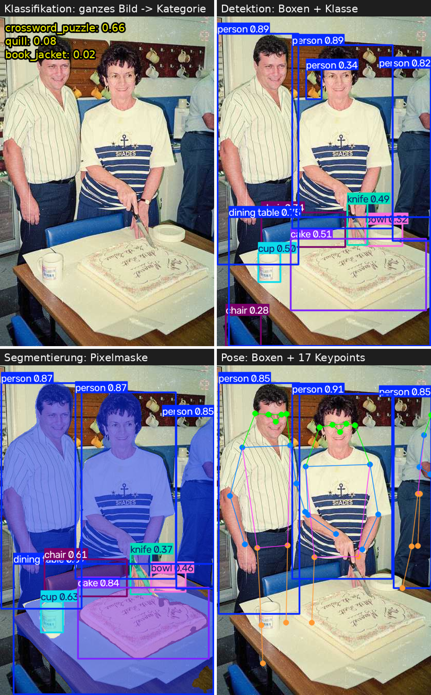
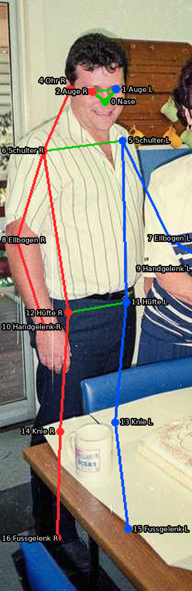
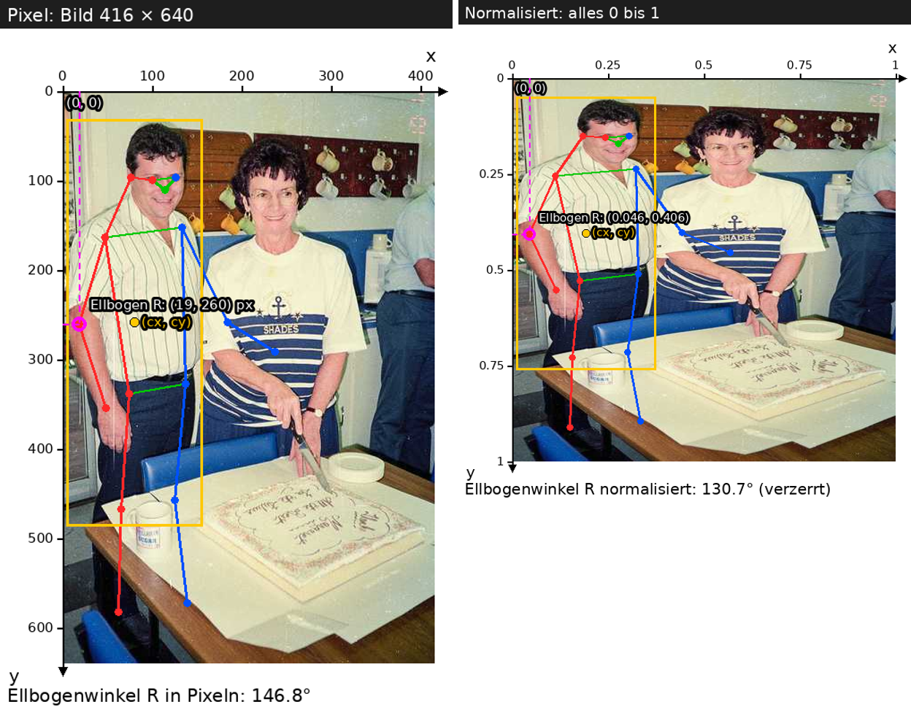
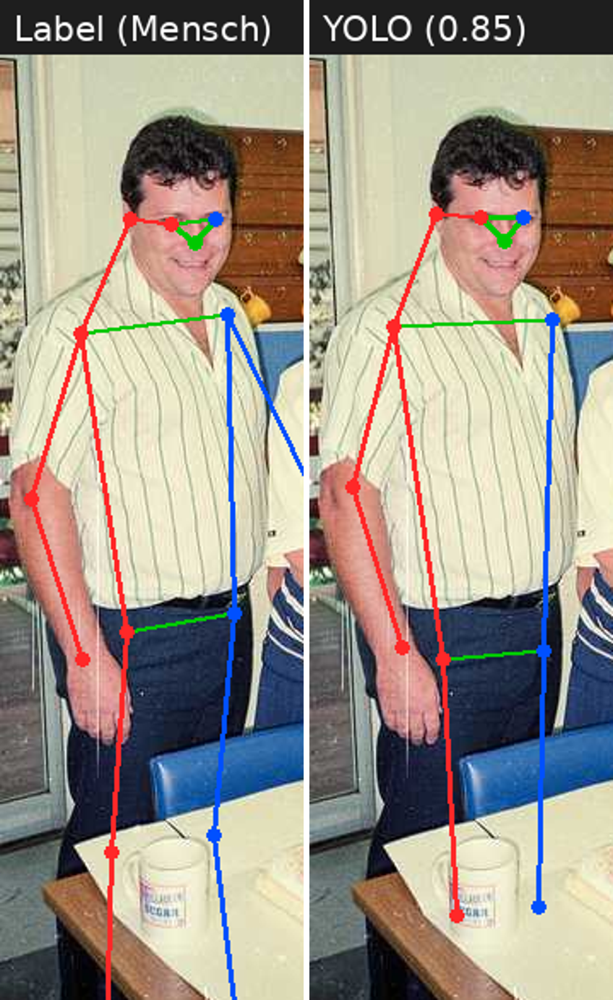

# Modul 323: Pose-Pipeline

Ihr baut eine Pipeline, die auf Bildern Personen erkennt, Gelenkpunkte bestimmt, das Ergebnis mit Labels vergleicht und im Video Bewegungen auswertet. Alles funktional in Python. Zuerst **implementiert** ihr (Runde 1), danach **erkennt ihr die FP-Prinzipien** in eurem eigenen Code (Runde 2).

## Inhalt

0. [Worum es geht](#0-worum-es-geht)
1. [YOLO und Pose](#1-yolo-und-pose)
2. [Runde 1: Implementieren](#2-runde-1-implementieren)
   - [Schritt 1: Daten laden](#schritt-1-daten-laden) · [2: Geometrie](#schritt-2-geometrie) · [3: Filtern](#schritt-3-filtern) · [4: YOLO](#schritt-4-yolo-inferenz) · [5: Auswerten](#schritt-5-auswerten) · [6: Video](#schritt-6-video) · [7: Bonus](#schritt-7-bonus-spiegeln)
3. [Runde 2: FP-Prinzipien](#3-runde-2-fp-prinzipien)
   - [3.0 FP ist überall](#30-fp-ist-überall) · [3.1](#31-schritt-1-unveränderlichkeit-und-aliasing) · [3.2](#32-schritt-2-reine-funktionen) · [3.3](#33-schritt-3-funktionen-als-werte-und-closures) · [3.4](#34-schritt-4-reiner-kern-unreine-schale-memoisierung) · [3.5](#35-schritt-5-fold-und-monoid) · [3.6](#36-schritt-6-zustand-als-wert) · [3.7 Bonus](#37-bonus-schritt-7)
4. [Journal und Abgabe](#4-journal-und-abgabe)
5. [Spickzettel](#5-spickzettel)

---

## 0. Worum es geht

**Die Pipeline in einem Satz:** Bild rein, Personen mit 17 Gelenkpunkten raus, mit den Labels vergleichen, daraus Winkel berechnen und Bewegungen zählen.

```
Labels (.txt) ─► Schritt 1: laden ─┐
                                   ├─► Schritt 3: filtern ─► Schritt 5: auswerten (PCK)
Bilder (.jpg) ─► Schritt 4: YOLO ──┘                              ▲
                      │                                           │
                      └─► Schritt 2: Pixel, Kniewinkel ──► Schritt 6: Video, Wiederholungen zählen
```

### Daten und Modell

Wir arbeiten mit zwei Quellen, die **dieselbe Art von Daten** liefern:

| | Testdaten mit Labels | Inferenz mit YOLO |
|---|---|---|
| Woher | **COCO8-Pose**: 8 Bilder aus dem öffentlichen COCO-Datensatz (4 `train`, 4 `val`), im Repo unter `data/coco8-pose/` | das vortrainierte Modell **YOLO11n-Pose** (`yolo11n-pose.pt`) |
| Was | Pro Bild eine Textdatei: Menschen haben für jede Person die 17 Gelenkpunkte von Hand markiert. Das ist die "richtige Antwort" | Das Modell bekommt nur das Bild und sagt die 17 Gelenkpunkte pro Person **vorher** |
| Wird bei uns zu | Personen (`Person`, Schritt 1) | Personen (`Person`, Schritt 4) |

Weil beide am Ende als `Person` vorliegen, können wir sie direkt vergleichen (Schritt 5) und mit denselben Funktionen weiterrechnen (Winkel in Schritt 2, Video in Schritt 6). Kapitel 1 zeigt, wie ähnlich die beiden Formate sind.

### Die zwei Runden

| | Runde 1: Implementieren | Runde 2: FP-Prinzipien |
|---|---|---|
| Was | Pro Schritt schreibt ihr nur die **Kernstücke**, der Rest liegt fertig im Repo | Prinzip benennen, in eurem Code finden, mit einem fertigen `bad/`-Skript **kaputt machen**, beobachten, erklären |
| KI | erlaubt und erwünscht | erlaubt, aber die Erklärung muss von euch kommen |

### Zeitplan (Richtwert, zusammen ca. 4 Stunden)

| Teil | Zeit |
|---|---|
| Setup + Kapitel 1 (YOLO und Pose lesen) | 20 min |
| Runde 1, Schritte 1 bis 6 | 2 h |
| Runde 2: Einstieg + Recherche im Betrieb | 30 min |
| Runde 2: FP-Prinzipien an den Schritten 1 bis 6 | 60 min |
| Journal fertig machen | 10 min |
| Schritt 7 | Bonus |

### Teams

Ihr arbeitet **zu zweit**. Teilt euch die Funktionen auf, aber lest den Code des anderen: Ihr müsst am Schluss beide alles erklären können.

### Setup

```bash
uv sync                # installiert alles (einmalig, dauert ein paar Minuten)
uv run pytest -q       # alle Tests: gegebener Code grün, eure Stubs rot
```

Am Anfang sind nur die Tests **eurer** Funktionen rot. Euer Ziel pro Schritt: die zugehörige Testdatei grün. Der Datensatz **COCO8-Pose** (8 Bilder) ist bereits im Repo. Das Modell `yolo11n-pose.pt` (6 MB) wird beim ersten Aufruf automatisch heruntergeladen. Alle Befehle startet ihr im Projektordner.

### Arbeiten mit KI

- KI-Assistenten sind **erlaubt**. Lasst euch Funktionen erklären, Fehlermeldungen deuten, Tests erläutern.
- **Verstehen, was ihr übernehmt.** Kopierter Code, den ihr nicht erklären könnt, gibt in Runde 2 Probleme.
- Gebt der KI die Docstrings und den Test mit: Sie liefert dann viel bessere Vorschläge.
- Im Journal notiert ihr pro Schritt: **Wo hat die KI geholfen? Wo lag sie falsch?**

---

## 1. YOLO und Pose

Dieses Kapitel ist **nur zum Lesen**. Ihr braucht kein Wissen über neuronale Netze, nur ein Bild davon, was aus dem Modell herauskommt.

### Was ist YOLO?

YOLO ("You Only Look Once") ist ein Modell, das ein Bild **einmal** ansieht und direkt Ergebnisse liefert: Boxen, Punkte, Masken. Wir benutzen ein fertig trainiertes Modell. Trainiert wird hier nichts.

### Vier Arten von Aufgaben



| Aufgabe | Frage ans Bild | Ausgabe |
|---|---|---|
| Klassifikation | Was ist das? | **eine** von 1000 festen Kategorien |
| Detektion | Was ist wo? | Boxen mit Klasse und Konfidenz |
| Segmentierung | Welche Pixel gehören dazu? | Masken |
| **Pose** (unsere) | Wo sind die Gelenke? | Box + 17 Punkte pro Person |

Die Klassifikation **muss** sich für eine feste Kategorie entscheiden. Zeigt man ihr ein Bild, das in keine passt, rät sie trotzdem, z.B. "crossword_puzzle". Merkt euch das: Modelle sagen immer etwas, auch wenn sie falsch liegen.

### Die 17 Keypoints



| Idx | Name | Idx | Name | Idx | Name |
|---|---|---|---|---|---|
| 0 | Nase | 6 | rechte Schulter | 12 | rechte Hüfte |
| 1 | linkes Auge | 7 | linker Ellbogen | 13 | linkes Knie |
| 2 | rechtes Auge | 8 | rechter Ellbogen | 14 | rechtes Knie |
| 3 | linkes Ohr | 9 | linkes Handgelenk | 15 | linkes Fussgelenk |
| 4 | rechtes Ohr | 10 | rechtes Handgelenk | 16 | rechtes Fussgelenk |
| 5 | linke Schulter | 11 | linke Hüfte | | |

Es gibt **keine Mund-Punkte**: Das Gesicht besteht aus Nase, Augen und Ohren. "Links" und "rechts" sind aus Sicht der Person, nicht des Betrachters. Für den Kniewinkel brauchen wir Hüfte, Knie, Fussgelenk: **11, 13, 15** (links) bzw. **12, 14, 16** (rechts).

### Eine Label-Zeile zerlegt

Pro Person eine Zeile in `data/coco8-pose/labels/*/<bild>.txt`. Hier die erste Person aus `000000000113.txt` (der Mann in den Abbildungen), Zahlen auf 3 Stellen gekürzt:

```
0  0.193 0.405 0.365 0.711   0.276 0.172 2   0.305 0.152 2   0.243 0.155 2   0 0 0   0.185 0.150 2   ...   0.334 0.895 1   0.151 0.911 1
└┬┘ └──────────┬─────────┘   └────────┬────┘ └───────┬─────┘ └─────┬─────┘ └──┬──┘ └─────┬─────┘         └────┬────┘     └────┬────┘
Klasse  Box: cx cy w h         Punkt 0 (Nase) Punkt 1 (l. Auge) Punkt 2 (r. Auge) Punkt 3  Punkt 4                Punkt 15      Punkt 16
```

Aufbau: `Klasse | cx cy w h | (x y v) × 17` = 1 + 4 + 51 = **56 Zahlen**.

| Feld | Bedeutung |
|---|---|
| Klasse | immer `0` (Person) |
| `cx cy w h` | Box-Mitte und Grösse |
| `x y` | Position des Punkts |
| `v` | Sichtbarkeit: **0** = nicht markiert, **1** = markiert aber verdeckt, **2** = markiert und sichtbar |

Alle Positionen und Grössen sind **normalisiert** (0 bis 1): `x` ist der Anteil der Bildbreite, `y` der Anteil der Bildhöhe. Für Pixel multipliziert man mit Breite bzw. Höhe (Schritt 2). Im Beispiel ist Punkt 3 (linkes Ohr) `0 0 0`: nicht markiert, die Position ist bedeutungslos.

### Koordinaten: normalisiert und Pixel



**Das Koordinatensystem von Bildern:** Der Ursprung `(0, 0)` liegt **oben links**. `x` wächst nach rechts, **`y` wächst nach unten** (anders als in der Mathematik).

| | Pixel | Normalisiert |
|---|---|---|
| Einheit | Bildpunkte | Anteil der Breite bzw. Höhe |
| Bereich | `x`: 0 bis Breite, `y`: 0 bis Höhe | `x` und `y`: 0 bis 1 |
| Beispiel (Ellbogen R oben, Bild 416 × 640) | `(19, 260)` | `(19 / 416, 260 / 640)` = `(0.046, 0.406)` |
| Wo | zum Zeichnen und Rechnen von Winkeln | in den Label-Dateien und in der YOLO-Ausgabe (`xywhn`, `xyn`) |

Umrechnen (das macht `to_pixels` in Schritt 2):

```python
x_px = x * breite        # auch cx und w der Box
y_px = y * hoehe         # auch cy und h der Box
```

**Warum normalisiert?** Die Zahlen hängen nicht von der Bildgrösse ab. Ein Label passt zum Bild, egal ob es in 416 × 640 oder verkleinert vorliegt.

**Warum Winkel in Pixeln?** Normalisiert wird jedes Bild auf ein Quadrat 1 × 1 "gequetscht" (rechte Hälfte der Abbildung): Ein hohes Bild wird in der Höhe stärker gestaucht als in der Breite. Strecken kippen, und Winkel stimmen nicht mehr. Im Beispiel: Ellbogenwinkel **146.8°** in Pixeln, aber **130.7°** normalisiert gerechnet.

**Die Box:** `cx cy` ist die **Mitte** der Box, nicht die Ecke oben links. Die Ecke oben links ist `(cx - w/2, cy - h/2)`.

### Die YOLO-Ausgabe hat denselben Aufbau

```python
from ultralytics import YOLO

model = YOLO("yolo11n-pose.pt")                          # Modell laden (lädt Gewichte)
results = model.predict(images, conf=0.25, verbose=False, device="cpu")  # images: Liste von PIL-Bildern
for r in results:                                        # ein Ergebnis pro Bild
    r.boxes.xywhn        # (n, 4)    Boxen cx cy w h, normalisiert   ← wie im Label
    r.boxes.conf         # (n,)      Konfidenz pro Person
    r.keypoints.xyn      # (n, 17, 2) Punkte x y, normalisiert        ← wie im Label
    r.keypoints.conf     # (n, 17)   Konfidenz pro Punkt              ← entspricht v
```

`n` ist die Anzahl erkannter Personen (kann 0 sein). Die Tensoren wandelt ihr mit `.tolist()` in normale Listen um.



| Label-Zeile | YOLO-Ausgabe |
|---|---|
| `cx cy w h` | `r.boxes.xywhn[i]` |
| `x y` pro Punkt | `r.keypoints.xyn[i][j]` |
| `v` pro Punkt | `r.keypoints.conf[i][j]` |
| (immer 1.0) | `r.boxes.conf[i]` (Konfidenz der Person) |

**Zwei Unterschiede**, die später wichtig werden:

1. **`v` ist nicht gleich `conf`.** Im Label ist `v` eine Sichtbarkeit (0/1/2), in der Vorhersage eine Konfidenz (0.0 bis 1.0, praktisch nie genau 0). "Markiert, wenn `v > 0`" gilt für Labels, **nicht** für Vorhersagen.
2. **YOLO liefert immer alle 17 Punkte.** Auch verdeckte oder ausserhalb des Bildes liegende Punkte werden geraten, nur mit tiefer Konfidenz.

### Unsere Datentypen

In `pipeline/types.py`, unveränderlich (`NamedTuple`):

```python
class Keypoint(NamedTuple):
    x: float
    y: float
    v: float                       # Label: 0, 1 oder 2. Vorhersage: Konfidenz 0..1

class Person(NamedTuple):
    box: tuple[float, float, float, float]   # cx, cy, w, h
    keypoints: tuple[Keypoint, ...]          # immer genau 17
    score: float = 1.0                       # Label: 1.0. Vorhersage: Konfidenz
```

---

## 2. Runde 1: Implementieren

Pro Schritt: Ziel, was schon gegeben ist, **eure Aufgabe** (die Funktionen mit `raise NotImplementedError` in der Datei), ein Hinweis in Richtung Lösung und wie ihr prüft. Die Docstrings in den Dateien beschreiben genau, was jede Funktion tun soll.

Allgemeine Regeln: **Funktionen verändern ihre Argumente nicht**, sie geben neue Werte zurück. Verwendet die Typen `Keypoint` und `Person`.

### Schritt 1: Daten laden

**Ziel:** Label-Dateien einlesen und in `Person`-Objekte umwandeln.

**Gegeben** (`pipeline/data.py`): `FEATURES`, `person_to_row`, `row_to_person`, `labelled_count`, `load_split`, `load_all`, `load_or_build`, `summary`. Sie bauen aus euren Personen ein Hugging-Face-`Dataset` und speichern es auf der Festplatte.

**Eure Aufgabe** (`pipeline/data.py`):

| Funktion | Eingabe | Ausgabe | Was passiert |
|---|---|---|---|
| `parse_label_line(line)` | **eine Zeile** als `str`, z.B. `"0 0.193 0.405 … 0.151 0.911 1"` | **eine** `Person`, oder `None` | 56 Zahlen → Box + 17 `Keypoint`. `None`, wenn die Zeile nicht genau 56 Zahlen hat oder etwas keine Zahl ist |
| `parse_label_file(text)` | **ganzer Dateiinhalt** als `str` (mehrere Zeilen, eine pro Person) | **Tupel von Personen** `tuple[Person, ...]`, z.B. 3 Personen für `000000000113.txt`; leere Datei → `()` | jede Zeile mit `parse_label_line`, ungültige (`None`) weglassen |

Das Lesen der Datei von der Festplatte (`Path.read_text()`) und das Bauen des Datasets erledigt das gegebene `load_split`. Eure Funktionen bekommen nur **Text** und geben **Werte** zurück.

**Hinweis:**

```python
nums = tuple(float(s) for s in line.split())        # 56 Zahlen
box = nums[1:5]                                     # cx cy w h
# Keypoint i steht an nums[5 + 3*i : 8 + 3*i]  ->  Keypoint(x, y, v)
```

**Prüfen:**

```bash
uv run pytest tests/test_data.py -q
uv run python -m pipeline.data      # Zusammenfassung pro Bild
```

Ihr solltet für COCO8 pro Split 4 Bilder sehen. Erwartung: alle Tests in `test_data.py` grün.

### Schritt 2: Geometrie

**Ziel:** Normalisierte Koordinaten in Pixel umrechnen und den Kniewinkel berechnen.

**Gegeben:** `KNEE_JOINTS` (Indizes von Hüfte, Knie, Fussgelenk pro Seite) und `pipeline/draw.py` komplett (`draw_skeleton` zeichnet ein Skelett auf ein Bild).

**Eure Aufgabe** (`pipeline/geometry.py`):

| Funktion | Eingabe | Ausgabe | Was passiert |
|---|---|---|---|
| `to_pixels(p, width, height)` | **eine** `Person` (normalisiert, 0..1) + Bildbreite und -höhe in Pixeln (`int`) | **eine neue** `Person` in Pixeln | `x * width`, `y * height` für alle 17 Punkte und die Box (`cx, w` mit Breite, `cy, h` mit Höhe). `v` und `score` bleiben |
| `angle_at(a, b, c)` | **drei** `Keypoint` (in Pixeln) | Winkel in Grad (`float`, 0 bis 180), oder `None` | Winkel **bei `b`** zwischen den Strecken `b→a` und `b→c`. `None`, wenn eine Strecke Länge 0 hat |
| `knee_angle(p_px, side)` | **eine** `Person` in Pixeln + `"left"` oder `"right"` | Kniewinkel in Grad (`float`), oder `None` | Hüfte, Knie, Fussgelenk der Seite aus `KNEE_JOINTS` holen, `angle_at` aufrufen. `None`, wenn einer der drei Punkte nicht markiert ist (`v <= 0`) |

Gestreckt ≈ 180°, tiefe Kniebeuge ≈ 70–90°.

**Hinweis:** Winkel zwischen zwei Vektoren über das Skalarprodukt.

```python
# cos(winkel) = (u · w) / (|u| · |w|)   mit u = a - b,  w = c - b
math.degrees(math.acos(cos))
# angle_at(Keypoint(1, 0, 2), Keypoint(0, 0, 2), Keypoint(0, 1, 2)) == 90.0
```

Rechnet **in Pixeln**, nicht in normalisierten Koordinaten (siehe [Koordinaten](#koordinaten-normalisiert-und-pixel) in Kapitel 1: 146.8° statt 130.7°). Tipp: `cos` vor `acos` auf [-1, 1] begrenzen (Rundungsfehler).

**Prüfen:**

```bash
uv run pytest tests/test_geometry.py -q
uv run python -m pipeline.geometry     # speichert ein Beispielbild mit Skelett in out/
```

Öffnet das Bild in `out/` und prüft, ob das Skelett auf der Person sitzt.

### Schritt 3: Filtern

**Ziel:** Bilder und Personen nach Kriterien auswählen, mit kleinen Funktionen, die man kombinieren kann.

**Gegeben** (`pipeline/filters.py`): `labelled` (Anzahl markierter Keypoints), `max_persons`, `knee_angles`, `angle_or`.

**Eure Aufgabe:**

| Funktion | Eingabe | Ausgabe | Was passiert |
|---|---|---|---|
| `min_labelled(n)` | eine Zahl `n` (`int`) | eine **Funktion** `Person -> bool` | die Funktion ist wahr, wenn die Person mindestens `n` markierte Keypoints hat |
| `any_person(pred)` | eine **Funktion** `Person -> bool` | eine **Funktion** `Zeile -> bool` (Zeile = ein Bild im Dataset, ein `dict`) | wahr, wenn **mindestens eine** Person im Bild `pred` erfüllt |
| `all_of(*preds)` | beliebig viele **Funktionen** `X -> bool` | eine **Funktion** `X -> bool` | wahr, wenn **alle** `preds` wahr sind. Ohne Argumente immer wahr |

Eine Dataset-Zeile sieht so aus: `{"file_name": "...", "image": <Bild>, "width": 416, "height": 640, "persons": [ {"box": [...], "keypoints": [[x, y, v], ...], "score": 1.0}, ... ]}`.

Die Funktionen geben also wieder Funktionen zurück.

**Hinweis:**

```python
at_least_8 = min_labelled(8)                 # eine Funktion
at_least_8(person)                           # True / False

keep = all_of(any_person(min_labelled(12)), max_persons(1))
filtered = ds["train"].filter(keep)          # Dataset.filter nimmt ein Prädikat auf Zeilen
```

Die Bild-Prädikate bekommen eine Dataset-Zeile (ein `dict`), die Personen darin sind `dict`s: wandelt sie mit `row_to_person` um.

**Prüfen:**

```bash
uv run pytest tests/test_filters.py -q
```

Zusätzlich: `ds["train"].filter(all_of(any_person(min_labelled(12)), max_persons(1)))` solltet ihr auf `ds = load_or_build()` ausprobieren. Probiert verschiedene Werte; ein Filter, der nichts verwirft, sagt wenig.

### Schritt 4: YOLO-Inferenz

**Ziel:** Das Modell auf allen Bildern eines Datasets laufen lassen und die Ergebnisse in unsere `Person`-Typen übersetzen. Teil C: eigenes Foto.

**Gegeben** (`pipeline/inference.py`): `FEATURES_WITH_PRED`, `WEIGHTS`, `KP_CONF`, `predict_split`, `predict_image`, `annotate` und die Kommandozeile. Dazu `run_own.py` und `visualize.py` komplett.

**Eure Aufgabe:**

| Funktion | Eingabe | Ausgabe | Was passiert |
|---|---|---|---|
| `get_model(weights)` | Dateiname der Gewichte (`str`), z.B. `"yolo11n-pose.pt"` | das **Modell** (`YOLO`) | `YOLO(weights)`. Mit `@lru_cache`, damit es nur **einmal** geladen wird |
| `result_to_persons(boxes_xywhn, boxes_conf, kps_xyn, kps_conf)` | **vier Listen** für die `n` erkannten Personen: `n × 4` Box-Zahlen, `n` Konfidenzen, `n × 17 × 2` Punkt-Koordinaten, `n × 17` Punkt-Konfidenzen (oder `None`) | **Tupel von Personen**, Länge `n`; keine Erkennung → `()` | **rein**: pro Person Box, 17 `Keypoint(x, y, konfidenz)` und `score`. Ist `kps_conf` `None`, wird `v = 1.0` |
| `_persons_of(result)` | **ein** YOLO-Ergebnis `r` (für ein Bild) | **Tupel von Personen** | die vier Felder aus Kapitel 1 mit `.tolist()` in Listen umwandeln, dann `result_to_persons` |
| `predict_batch(batch, weights, conf)` | ein **Batch** aus dem Dataset: `dict` mit Listen, z.B. `batch["image"]` = Liste von 4 Bildern | `{"pred": [...]}`: pro Bild eine Liste von Personen-`dict`s | Bilder zu RGB, `model.predict(...)` auf alle Bilder, pro Ergebnis `_persons_of`, jede Person mit `person_to_row` zum `dict` |
| `confident(p, kp_conf=0.5)` | **eine** vorhergesagte `Person` + Schwelle | **eine neue** `Person` | **rein**: Punkte mit Konfidenz `< kp_conf` bekommen `v = 0` (gelten als nicht markiert), alles andere bleibt |

So hängen die Funktionen zusammen:

```
batch["image"] ─► get_model(...).predict(...) ─► ein Ergebnis r pro Bild
    r ─► _persons_of(r): .xywhn/.conf/.xyn/.conf als Listen ─► result_to_persons ─► Personen
    Personen ─► person_to_row ─► {"pred": ...}                (predict_batch)
```

**Hinweis:** Die API aus Kapitel 1, in Teilen:

```python
@lru_cache(maxsize=None)
def get_model(weights: str) -> YOLO:
    ...                                     # eine Zeile: YOLO(weights)

# in predict_batch:
images = [im.convert("RGB") for im in batch["image"]]      # Graustufenbilder gibt es auch!
results = get_model(weights).predict(images, conf=conf, verbose=False, device="cpu")
# pro Ergebnis r -> _persons_of(r) -> person_to_row(p) für jede Person

# in _persons_of:
r.boxes.xywhn.tolist()     # [[cx, cy, w, h], ...]  eine Liste pro Person
r.keypoints.conf           # kann None sein, sonst ebenfalls .tolist()
```

Probiert es zuerst interaktiv aus (`uv run python`), mit einem Bild aus `data/coco8-pose/images/val/`, und schaut euch die vier Felder an. So seht ihr, wie wenig Code das Modell braucht.

`confident` wegen Unterschied 1 aus Kapitel 1: Bei Vorhersagen ist `v` die Konfidenz. Ohne `confident` würde `knee_angle` auch für **geratene** Knie einen Winkel liefern.

```python
confident(person, 0.5)    # Punkte mit v < 0.5 bekommen v = 0, alles andere bleibt
```

**Prüfen (Teil A und B):**

```bash
uv run pytest tests/test_inference.py -q
uv run python -m pipeline.inference data/coco8-pose/images/val/000000000110.jpg
```

Der zweite Befehl schreibt `out/annotated.png` und druckt die Kniewinkel. Beim ersten Mal wird das Modell geladen, das dauert einen Moment. Das Bild muss ein Skelett auf der Person zeigen. Mit `uv run python visualize.py` bekommt ihr zusätzlich Label und Vorhersage nebeneinander in `out/vis_val.png`.

**Teil C: eigenes Foto**

1. Legt ein Foto in den Ordner `eigene/` (Ordner anlegen, falls er fehlt). Am besten **von der Seite**, **ganzer Körper** im Bild, gut beleuchtet. Handyfotos sind in Ordnung: Drehung (EXIF), Farbformat und Grösse werden von `run_own.py` automatisch korrigiert.
2. ```bash
   uv run python run_own.py
   ```
3. Ergebnisse (Skelett und Kniewinkel) liegen in `out/eigene/`.

Fragen für euch (fürs Journal): Funktioniert die Erkennung gut? Wie ändert sich der Winkel, wenn das Knie verdeckt ist? Eigene Fotos kommen **nicht** ins Repo.

### Schritt 5: Auswerten

**Ziel:** Messen, wie gut die Vorhersagen sind: **PCK**, der Anteil der Punkte, die nahe genug am Label liegen.

**Idee:** Ein vorhergesagter Punkt ist "richtig", wenn er höchstens `ALPHA × Personengrösse` vom Label-Punkt entfernt ist (Personengrösse = grössere Seite der Label-Box, in Pixeln). Gezählt werden nur **markierte** Label-Punkte.

**Gegeben** (`pipeline/evaluate.py`): `Counts` (`correct`, `total`), `ZERO`, `ALPHA`, `_dist`, `match` (ordnet einer Label-Person die beste Vorhersage zu), `image_counts`. `run_pipeline.py` komplett.

**Eure Aufgabe:**

| Funktion | Eingabe | Ausgabe | Was passiert |
|---|---|---|---|
| `person_counts(gt_px, pred_px, alpha)` | **eine** Label-Person, **eine** dazu passende Vorhersage oder `None` (beide in Pixeln), `alpha` (`float`, z.B. 0.1) | **ein** `Counts(correct, total)` | für jeden **markierten** Label-Punkt: Abstand zum gleichen Punkt der Vorhersage ≤ `alpha × Personengrösse` → richtig. `total` = Anzahl markierter Label-Punkte. Ist `pred_px` `None`: `Counts(0, total)` |
| `add_counts(a, b)` | **zwei** `Counts` | **ein** `Counts` | komponentenweise addieren |
| `pck(c)` | **ein** `Counts` | Anteil (`float`, 0..1) oder `None` | `correct / total`, `None` wenn `total == 0` |

Das Zuordnen "welche Vorhersage gehört zu welcher Label-Person" (`match`) und das Zusammenzählen über alle Personen eines Bildes (`image_counts`) sind gegeben.

**Hinweis:** Kleines Handbeispiel zum Prüfen im Kopf: Box 100 × 80 px (Personengrösse 100), zwei markierte Punkte bei (10, 10) und (50, 50). Die Vorhersage liegt 2 px vom ersten und 500 px vom zweiten entfernt, `ALPHA = 0.1` ergibt eine Toleranz von 10 px:

```python
person_counts(gt, pred, 0.1) == Counts(1, 2)
add_counts(Counts(1, 2), Counts(3, 4)) == Counts(4, 6)
```

**Prüfen:**

```bash
uv run pytest tests/test_evaluate.py -q
uv run python run_pipeline.py
```

`run_pipeline.py` lädt, filtert, macht Inferenz auf `val` und gibt PCK pro Bild und gesamt aus. Erwartung: Gesamt-PCK etwa **0.78** (90 von 116 Punkten). Ein Bild hat deutlich weniger als die anderen.

### Schritt 6: Video

**Ziel:** Ein eigenes Video auswerten. Das Thema ist offen, wählt etwas, das euch interessiert. Teams **filmen sich gegenseitig**: kurz, von der Seite, ganzer Körper, ruhige Kamera.

**Optionen:**

- **Wiederholungen zählen:** Kniebeugen, Liegestütze, Hampelmann.
- **Winkel über Zeit:** z.B. Kniewinkel in der Hockey-Stellung oder bei einem Schuss.
- **Kampfsport:** Kicks zählen (Fussgelenk höher als Hüfte) oder die maximale Streckung des Beins messen.
- **Links/rechts vergleichen:** Ist ein Bein beweglicher als das andere?

**Gegeben** (`pipeline/reps.py`): `RepState`, `START`, die Schwellen (`DOWN_BELOW`, `UP_ABOVE`), `frames` (Generator, ein Bild nach dem anderen), `angles` (Kniewinkel pro Bild), `drop_missing`, `states`. `run_squats.py` komplett.

**Eure Aufgabe** (`pipeline/reps.py`):

| Funktion | Eingabe | Ausgabe | Was passiert |
|---|---|---|---|
| `step(state, angle)` | **ein** `RepState` (z.B. `RepState("up", 3)`) + **ein** Winkel (`float`) | **ein neuer** `RepState` | ein Schritt des Zustandsautomaten (Regeln unten) |
| `count_reps(xs)` | **Liste von Winkeln**, ein Winkel pro Videobild, z.B. `[170, 90, 165, 85, 170]` | Anzahl Wiederholungen (`int`), hier `2` | `step` über die ganze Liste anwenden, beginnend bei `START`, am Schluss `.count` |
| `ema(xs, alpha)` | **Liste von Winkeln** + `alpha` (`float`, 0..1) | **Liste** gleicher Länge, geglättet | `s_neu = alpha * x + (1 - alpha) * s_alt`, erster Wert bleibt. Leere Liste → `[]` |

Die Winkel-Liste kommt aus dem gegebenen `angles` (pro Videobild ein Kniewinkel oder `None`), `None` entfernt das gegebene `drop_missing`.

`step` hat **zwei Schwellen** (Hysterese): von `up` nach `down` unter `DOWN_BELOW` (100°), von `down` nach `up` über `UP_ABOVE` (160°), dabei zählt `count` eins hoch.

**Hinweis:**

```python
step(RepState("up", 0), 90)        # RepState("down", 0)
step(RepState("down", 0), 170)     # RepState("up", 1)
step(RepState("up", 0), 130)       # RepState("up", 0)   (nichts passiert)
# count_reps = ein Fold: reduce(step, xs, START).count
# ema = accumulate(...)   (itertools); Startwert ist das erste Element
```

**Prüfen:**

```bash
uv run pytest tests/test_reps.py -q
uv run python run_squats.py video.mp4 --plot
```

`run_squats.py` zählt Wiederholungen und speichert mit `--plot` den Winkelverlauf in `out/angles.png` (`--side right` für das rechte Bein). Für andere Auswertungen schreibt ihr ein eigenes kleines Skript, das `frames`, `angles` und eure Funktionen kombiniert. Videos kommen **nicht** ins Repo.

### Schritt 7: Bonus: Spiegeln

Daten verdoppeln, indem man Bilder spiegelt: Die Labels müssen **mitgespiegelt** werden, und links/rechts tauschen.

| Funktion | Eingabe | Ausgabe | Was passiert |
|---|---|---|---|
| `hflip_keypoint(k)` | **ein** `Keypoint` (normalisiert) | **ein neuer** `Keypoint` | markiert: `x → 1 - x`; nicht markiert (`v == 0`): unverändert |
| `hflip_person(p)` | **eine** `Person` (normalisiert) | **eine neue** `Person` | alle Punkte spiegeln, dann nach `FLIP_INDEX` neu ordnen (linkes Auge ↔ rechtes Auge usw.). Box: `cx → 1 - cx` |

```bash
uv run pytest tests/test_augment.py -q
```

---

## 3. Runde 2: FP-Prinzipien

Euer Code läuft. Jetzt schauen wir, **warum er so gebaut ist**. Funktionale Programmierung (FP) ist keine Spezialität von Haskell: Ihr trefft die Prinzipien fast überall, wo ihr arbeitet.

### 3.0 FP ist überall

| Sprache / Framework | Typische FP-Prinzipien |
|---|---|
| **Python** | `map`/`filter`, Comprehensions, `functools.reduce`/`partial`/`lru_cache`, `itertools`, `@dataclass(frozen=True)`, Generatoren |
| **React (+ Redux)** | Komponenten sind reine Funktionen ihrer Props; State wird nie verändert, sondern ersetzt; Reducer `(state, action) -> state` (wie `step` in Schritt 6) |
| **Apache Spark / PySpark** | unveränderliche Datasets, `map`/`filter`/`reduce`, lazy Auswertung (verwandt mit Hugging Face `datasets`) |
| **Java** | Streams, Lambdas, Records |
| **C#** | LINQ (`Select`, `Where`, `Aggregate`) |
| **JavaScript / TypeScript** | `map`/`filter`/`reduce`, Spread-Kopien (`{...obj}`, `[...arr]`) |
| **SQL** | deklarativ: Ergebnis beschreiben, nicht Schritte |
| **Kotlin / Scala / F#** | FP als Teil der Sprache: Immutability, Pattern Matching, Higher-Order Functions |

### Recherche im Betrieb (pro Person, ca. 20 min)

Fragt Kolleginnen und Kollegen, schaut in Projekte oder Dokumentationen eures Lehrbetriebs:

- Welche **Sprachen** und **Frameworks** verwendet euer Betrieb?
- Welches **Software-Design** steckt dahinter (z.B. Web-App, Microservices, Datenpipeline, Event-getrieben)?
- Welche **FP-Prinzipien** sind dort am prominentesten, und **wo zeigen sie sich**?

Schreibt **3 bis 5 Sätze pro Person** ins Journal (Abschnitt "FP-Recherche").

**Beispiel-Antwort (React):**
> Unser Betrieb baut Web-Oberflächen mit React und Redux. Eine Komponente ist eine Funktion, die aus Props die Anzeige berechnet, ohne etwas zu verändern: das ist eine reine Funktion. Der State wird nie direkt verändert, sondern im Reducer `(state, action) -> state` durch einen neuen Wert ersetzt. Das macht Fehler nachvollziehbar, weil man jede Aktion einzeln abspielen kann. Das ist dasselbe Muster wie `step` in unserer Kniebeugen-Zählung.

Wenn ihr in eurem Betrieb wenig Offensichtliches findet: Das ist selbst eine Aussage. Schaut, welche Prinzipien trotzdem versteckt vorkommen (z.B. `map`/`filter` im Code, SQL-Abfragen, Streams).

### Ablauf der Abschnitte 3.1 bis 3.6

Pro Abschnitt:

1. **Prinzip**: kurz erklärt.
2. **Wo in eurem Code**: Schaut euch die Stelle an.
3. **Kaputt machen**: Das Skript in `bad/` ist **fertig**, ihr startet es nur.
4. **Beobachtet**: 2 bis 3 Fragen. Antwortet im Journal in euren eigenen Worten.
5. **Reparieren**: nur bei 3.3 und 3.4.

Die `bad/`-Skripte brauchen die Lösungen aus Runde 1 (die Funktionen müssen laufen). Startet immer **vom Projektordner** mit `-m` (kein `/` im Namen, kein `.py`).

### 3.1 Schritt 1: Unveränderlichkeit und Aliasing

**Prinzip:** Wenn Daten unveränderlich sind, kann niemand sie hinter eurem Rücken ändern. Veränderbare Daten (Listen, Dicts) haben ein Problem: Zwei Namen können auf **dasselbe** Objekt zeigen (Aliasing), und eine Änderung über den einen Namen sieht man am anderen. In Haskell ist alles unveränderlich, `Person` und `Keypoint` sind deshalb `NamedTuple`s.

**Wo in eurem Code:** `Keypoint`/`Person` in `pipeline/types.py` und `parse_label_file`, die ein **Tupel** zurückgibt.

**Kaputt machen:**

```bash
uv run python -m bad.b1_clean_inplace
```

Das Skript entfernt "unmarkierte" Keypoints direkt aus einer Liste, in einer Schleife.

**Beobachtet:**

1. Sind nachher wirklich alle unmarkierten Punkte weg? Wie viele Keypoints haben die Personen vorher und nachher?
2. `before` und `rows` waren zwei Namen. Was ist mit `before` passiert und warum?
3. Warum zeigt `kps[13]` nach dem Aufräumen auf einen anderen Punkt (oder gibt einen `IndexError`)? Was ändert sich daran, wenn `Person.keypoints` ein Tupel ist?

### 3.2 Schritt 2: Reine Funktionen

**Prinzip:** Eine **reine** Funktion liefert bei gleichen Argumenten immer dasselbe Ergebnis und hat keine Nebenwirkungen (verändert nichts ausserhalb). Reine Funktionen kann man einzeln testen, in beliebiger Reihenfolge aufrufen und beliebig oft wiederholen. Man nennt das **referenzielle Transparenz**: Man könnte den Aufruf durch sein Ergebnis ersetzen.

**Wo in eurem Code:** `to_pixels`, `angle_at`, `knee_angle` in `pipeline/geometry.py`. `to_pixels` gibt eine **neue** Person zurück.

**Kaputt machen:**

```bash
uv run python -m bad.b2_pixels_inplace
```

Das Skript hat eine `to_pixels_inplace`-Variante, die die Koordinaten in der Datenstruktur überschreibt.

**Beobachtet:**

1. Wie ändern sich Knie-Koordinaten und Winkel beim zweiten Aufruf auf demselben Objekt?
2. Was passiert, wenn man die Reihenfolge "Winkel berechnen / Skelett zeichnen" vertauscht? Wäre das bei eurer reinen `to_pixels` auch so?
3. Wie stark weicht der Winkel nach der Doppel-Skalierung ab? Warum ändert sich ein Winkel nicht, wenn man x und y mit **demselben** Faktor skaliert, hier aber schon?

### 3.3 Schritt 3: Funktionen als Werte und Closures

**Prinzip:** In FP sind Funktionen **Werte**: Man kann sie übergeben, zurückgeben und in Listen speichern (Higher-Order Functions: `filter`, `map`, `any_person`, `all_of`). Eine **Closure** ist eine Funktion, die Werte aus ihrer Umgebung "mitnimmt" (bei euch das `n` in `min_labelled(n)`). Vorsicht: Eine Closure merkt sich die **Variable**, nicht ihren Wert, solange die Variable veränderbar ist (Late Binding). Haskell kennt das Problem nicht: Ein Name ist an genau einen Wert gebunden.

**Wo in eurem Code:** `min_labelled`, `any_person`, `all_of` in `pipeline/filters.py`.

**Kaputt machen:**

```bash
uv run python -m bad.b3_late_binding
```

Es zählt Personen mit mindestens 3, 8 und 12 markierten Keypoints, einmal mit Lambdas in einer Schleife, einmal mit `min_labelled(n)`.

**Beobachtet:**

1. Was fällt an der ersten Zeile (Lambdas in der Comprehension) auf? Welche Zahlen erwartet ihr, welche seht ihr?
2. Welchen Wert von `n` benutzen die Lambdas, und **wann** wird er nachgeschlagen?
3. Warum verhält sich `min_labelled(n)` anders?

**Reparieren:** Ersetzt in `bad/b3_late_binding.py` die Lambdas in der Schleife durch Aufrufe von `min_labelled(n)` (es steht schon als Vergleich im Skript). Probiert alternativ `lambda p, n=n: ...` (Default-Argument) aus und erklärt, warum das auch geht.

### 3.4 Schritt 4: Reiner Kern, unreine Schale, Memoisierung

**Prinzip:** Programme brauchen Nebenwirkungen (Dateien laden, Modell starten), aber man hält sie in einer dünnen **Schale** und den Rest als **reinen Kern**. `result_to_persons` ist rein und einfach zu testen; `get_model` und `predict_batch` sind die unreine Schale. **Memoisierung** (`lru_cache`) darf man nur bei reinen Funktionen einsetzen, denn der Cache merkt sich Ergebnis pro **Argumente**. Hängt das Ergebnis von mehr ab (z.B. einer globalen Variable), liefert der Cache veraltete Werte. In Haskell macht der Typ (`IO`) die Unreinheit sichtbar.

**Wo in eurem Code:** `result_to_persons` (Kern) gegen `get_model`, `predict_batch`, `_persons_of` (Schale). `get_model` ist mit `lru_cache` memoisiert: Das ist okay, weil das Argument `weights` das Ergebnis vollständig bestimmt.

**Kaputt machen:**

```bash
uv run python -m bad.b4_stale_cache
```

Eine Funktion `count_people` zählt Personen auf Bild 110, liest dabei aber ein globales `CONF` und ist mit `lru_cache` memoisiert. Das Skript ändert `CONF` und ruft nochmals auf.

**Beobachtet:**

1. Welche zwei Zahlen druckt das Skript für `count_people`, welche erwartet ihr nach `CONF = 0.9`?
2. Wieso rechnet die zweite Ausführung nicht neu? Was ist der Schlüssel des Caches?
3. Wieso ist `count_people` "nicht rein"? Was druckt `fixed`?

**Reparieren:** Das Skript enthält `count_people_fixed(path, conf)`. Schreibt `count_people` selber so um, dass `conf` ein **Argument** ist, und erklärt, warum der Cache jetzt stimmt.

**Optional:** Das Dataset-`map` hat auch einen Cache (Dateien `cache-*.arrow` unter `data/coco8-pose-ds/`, gilt nur für Datasets, die von der Festplatte mit `load_from_disk` geladen wurden). Was passiert, wenn `predict_batch` ein globales `CONF` aus einem **importierten Modul** liest statt `conf` als Argument? Ändert `CONF`, startet erneut und schaut, ob neu gerechnet wird. `predict_split` gibt `conf` darum über `fn_kwargs` weiter.

### 3.5 Schritt 5: Fold und Monoid

**Prinzip:** Ein **Fold** (`reduce`, in Haskell `foldl`) faltet eine Liste mit einer Funktion zu einem Wert. Das klappt besonders gut, wenn die Funktion **assoziativ** ist und einen **neutralen Wert** hat (zusammen: ein **Monoid**): `add_counts` mit `ZERO`. Dann ist die Reihenfolge und Aufteilung egal, man kann Teile parallel berechnen (Spark!) und wieder zusammensetzen. Mittelwerte von Mittelwerten sind **nicht** assoziativ, darum zählt man `correct` und `total` getrennt und teilt erst am Schluss.

**Wo in eurem Code:** `add_counts` + `ZERO` in `pipeline/evaluate.py`, der Fold `reduce(add_counts, ..., ZERO)` in `image_counts` und `run_pipeline.py`.

**Kaputt machen:**

```bash
uv run python -m bad.b5_average
```

Das Skript fasst PCK-Werte mit `avg2(a, b) = (a + b) / 2` zusammen statt `Counts` zu addieren, vorwärts, rückwärts, und mit Teilen aus `ds_pred.shard(3, i)`.

**Beobachtet:**

1. `reduce(avg2, [1.0, 0.5, 0.0])` gegen die umgekehrte Liste: Was kommt heraus, und was folgt daraus für die Reihenfolge?
2. Wie unterscheidet sich der Mittelwert über die Bilder vom korrekten Gesamt-PCK mit `add_counts`? Welche Bilder zählen bei `avg2` zu viel?
3. Wie ändert sich das Ergebnis von `add_counts`, wenn ihr die Teile in anderer Reihenfolge zusammensetzt? Warum ist das bei `avg2` anders?

### 3.6 Schritt 6: Zustand als Wert

**Prinzip:** Wo Zustand nötig ist (Wiederholungszähler), packt man ihn in einen **Wert** (`RepState`) und schreibt eine reine Funktion `step(state, event) -> neuer state`. Das ist ein **Reducer** wie in Redux. `count_reps` ist dann nur ein Fold über die Winkel. Es gibt keinen versteckten globalen Zähler: gleiche Eingabe, gleiches Ergebnis. `ema` ist ein **Scan** (Fold, der alle Zwischenschritte behält), `frames` ein **Generator** (lazy: ein Bild nach dem anderen im Speicher).

**Wo in eurem Code:** `step`, `count_reps`, `ema` in `pipeline/reps.py`; `RepState`, `START`, `frames`, `states` (gegeben).

**Kaputt machen:**

```bash
uv run python -m bad.b6_reps
```

Das Skript vergleicht einen **globalen** Zähler mit eurem reinen `count_reps`.

**Beobachtet:**

1. Was gibt `count_reps_global` beim 1. und beim 2. Aufruf auf derselben Eingabe zurück, was euer `count_reps`?
2. Welche Information steckt bei der globalen Version in `count` und `phase`, und wo steckt sie bei `RepState`?
3. Wie würdet ihr die globale Version testen? Und eure?

### 3.7 Bonus: Schritt 7

Nur wenn ihr Schritt 7 gemacht habt:

```bash
uv run python -m bad.b7_flip
```

Teile (a) und (b): Spiegeln ohne links/rechts zu tauschen, und der Test `hflip(hflip(p)) == p`.

**Beobachtet:** (a) Was sieht man auf den Bildern `out/`, wenn links/rechts nicht getauscht werden? (b) Besteht der Test `hflip(hflip(p)) == p` auch bei der falschen Version? Was sagt das über die Aussagekraft von Tests?

---

## 4. Journal und Abgabe

Das Journal ist die Vorlage `journal.md` im Repo. Ihr füllt es **laufend** aus, nicht erst am Schluss.

**Runde 1:** pro Schritt kurz: Was haben wir implementiert? Was war schwierig? Wo hat die KI geholfen, wo lag sie falsch?
**FP-Recherche:** pro Person 3 bis 5 Sätze zum Betrieb.
**Runde 2:** pro Schritt: Was ging kaputt (Beobachtung)? Welches FP-Prinzip verhindert das? Bezug zu eurem Betrieb?
**Fazit:** 3 bis 4 Sätze.

### Abgabe

Euer **privates** Repo (Lehrperson als Collaborator) mit:

- [ ] allen Tests grün (`uv run pytest -q`)
- [ ] `uv run python run_pipeline.py` läuft
- [ ] Video-Ergebnis (Skript, Plot oder kurze Beschreibung; das Video selbst nicht committen)
- [ ] `journal.md` ausgefüllt
- [ ] ein Commit pro Schritt, mit aussagekräftiger Nachricht

### Bewertung

*(wird von der Lehrperson ergänzt)*

---

## 5. Spickzettel

| Idee | Python | Haskell |
|---|---|---|
| Liste umwandeln | `[f(x) for x in xs]`, `map(f, xs)` | `map f xs` |
| Liste filtern | `[x for x in xs if p(x)]`, `filter(p, xs)` | `filter p xs` |
| Zusammenfalten | `reduce(f, xs, start)` | `foldl f start xs` |
| Zwischenergebnisse | `accumulate(xs, f, initial=s)` | `scanl f s xs` |
| Teil-Anwendung | `partial(f, a)` | `f a` |
| Funktion zurückgeben | `def g(n): return lambda x: ...` | `g n = \x -> ...` |
| Unveränderlich | `NamedTuple`, Tupel, `frozen=True` | alles |
| Kopie mit Änderung | `p._replace(...)`, `{**d, "k": v}` | `p { field = v }` |
| Fehlender Wert | `Optional[X]` (`None`) | `Maybe X` |
| `None` weglassen | `[x for x in xs if x is not None]` | `catMaybes` / `mapMaybe` |
| Default bei `None` | `x if x is not None else d` | `fromMaybe d x` |
| Lazy Folge | Generator mit `yield` | normale Liste (lazy) |
| Memoisierung | `@lru_cache` (nur bei reinen Funktionen!) | nicht nötig (rein) |

### Befehle

| Was | Befehl |
|---|---|
| Alle Tests | `uv run pytest -q` |
| Tests eines Schritts | `uv run pytest tests/test_<x>.py -q` |
| Gesamtlauf mit PCK | `uv run python run_pipeline.py` |
| Label und Vorhersage als Bild | `uv run python visualize.py` (Ausgabe `out/`) |
| Eigene Fotos | `uv run python run_own.py` (Fotos in `eigene/`, Ausgabe `out/eigene/`) |
| Video auswerten | `uv run python run_squats.py video.mp4 --plot` |
| Fehler provozieren | `uv run python -m bad.<name>` |
